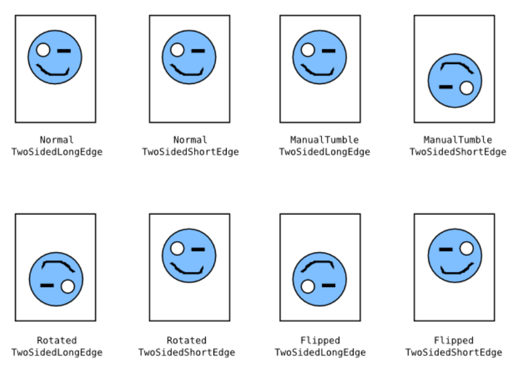
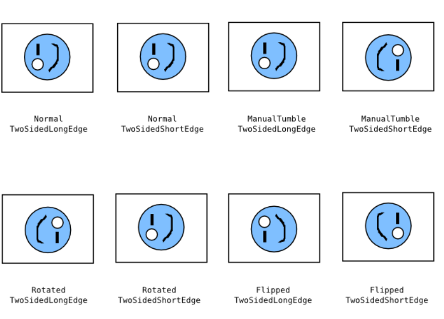
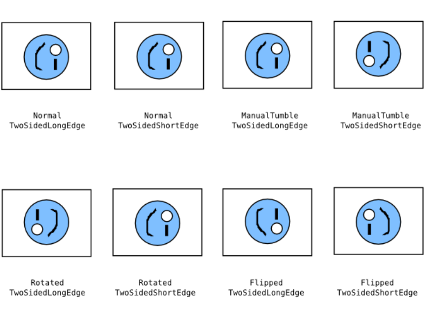
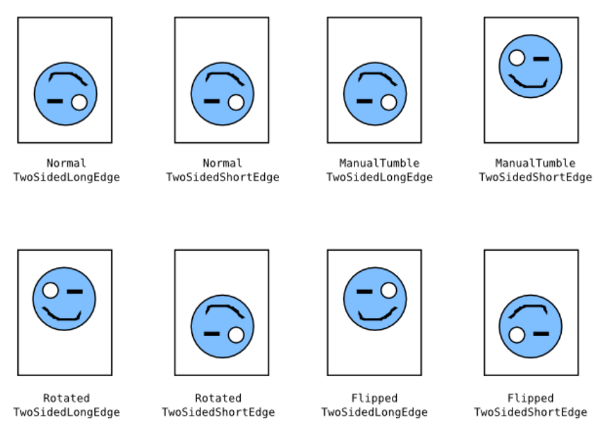

# IPP Everywhere™ v1.1 (PWG 5100.14-2020)


> Converted from cs-ippeve11-20200515-5100.14.pdf — PWG Candidate Standard, May 15, 2020, 60 pages.
>
> Conversion notes: page headers/footers and margin line numbers removed; 4 figures embedded under **assets/**; wrapped table cells use <br>; underlined links use <u>; body text verified against the PDF via token-level completeness check.

## Table of Contents

- 1. Introduction *(PDF p.7)*
- 2. Terminology *(PDF p.7)*
  - 2.1 Conformance Terminology *(PDF p.7)*
  - 2.2 Printing Terminology *(PDF p.7)*
  - 2.3 Protocol Role Terminology *(PDF p.8)*
  - 2.4 Other Terminology *(PDF p.8)*
  - 2.5 Acronyms and Organizations *(PDF p.9)*
- 3. Requirements *(PDF p.10)*
  - 3.1 Rationale *(PDF p.10)*
  - 3.2 Use Cases *(PDF p.11)*
    - 3.2.1 Select Printer *(PDF p.11)*
      - 3.2.1.1 Select the Last Used Printer *(PDF p.11)*
      - 3.2.1.2 Select Printer Using Name or Address *(PDF p.12)*
      - 3.2.1.3 Select Printer Using URI *(PDF p.12)*
      - 3.2.1.4 Select Printer Using a Directory Service *(PDF p.12)*
      - 3.2.1.5 Select Printer Using a Cloud Service *(PDF p.12)*
      - 3.2.1.6 Select Printer Using a Discovery Protocol *(PDF p.12)*
      - 3.2.1.7 Select Printer Using Geo-Location *(PDF p.13)*
      - 3.2.1.8 Select Printer Using Out of Band Method *(PDF p.13)*
      - 3.2.1.9 Select Printer Using Properties *(PDF p.13)*
    - 3.2.2 Print *(PDF p.13)*
      - 3.2.2.1 Print a Document *(PDF p.14)*
      - 3.2.2.2 Print a Document by Reference *(PDF p.14)*
      - 3.2.2.3 Print Using Loaded Media *(PDF p.14)*
      - 3.2.2.4 Print a Secure Form *(PDF p.14)*
      - 3.2.2.5 Print with Special Formatting *(PDF p.15)*
      - 3.2.2.6 Print and Select at Printer *(PDF p.15)*
      - 3.2.2.7 Print to a Service *(PDF p.16)*
      - 3.2.2.8 Print to a Recipient *(PDF p.16)*
      - 3.2.2.9 Print with a Proof Copy *(PDF p.16)*
    - 3.2.3 Exceptions *(PDF p.16)*
      - 3.2.3.1 Print Action Canceled *(PDF p.16)*
      - 3.2.3.2 Select Printer Canceled *(PDF p.16)*
      - 3.2.3.3 Printer No Longer Network Accessible after Selection *(PDF p.17)*
      - 3.2.3.4 Not Authorized *(PDF p.17)*
      - 3.2.3.5 Needs Authentication *(PDF p.17)*
      - 3.2.3.6 Not Accepting Jobs *(PDF p.17)*
      - 3.2.3.7 Job Ticket or Document Format Not Supported *(PDF p.17)*
      - 3.2.3.8 Job or Document Processing Failures *(PDF p.17)*
      - 3.2.3.9 Printer Fault *(PDF p.17)*
      - 3.2.3.10 Printer Warning *(PDF p.18)*
  - 3.3 Out of Scope *(PDF p.18)*
  - 3.4 Design Requirements *(PDF p.18)*
- 4. Discovery Protocols *(PDF p.19)*
  - 4.1 Printer Description Attributes Used in Discovery *(PDF p.19)*
  - 4.2 DNS Service Discovery (DNS-SD) *(PDF p.20)*
    - 4.2.1 IPP Everywhere™ Service Subtypes *(PDF p.20)*
    - 4.2.2 Service (SRV) Instance Name *(PDF p.20)*
    - 4.2.3 Geo-Location (LOC) *(PDF p.21)*
    - 4.2.4 Text (TXT) *(PDF p.21)*
      - 4.2.4.2 air *(PDF p.23)*
      - 4.2.4.3 pdl *(PDF p.26)*
      - 4.2.4.4 TLS *(PDF p.26)*
      - 4.2.4.5 UUID *(PDF p.26)*
      - 4.2.4.6 DUUID *(PDF p.27)*
  - 4.3 LDAP and SLP Discovery *(PDF p.27)*
- 5. Protocol Binding *(PDF p.28)*
  - 5.1 HTTP Features *(PDF p.28)*
    - 5.1.1 Host *(PDF p.28)*
    - 5.1.2 If-Modified-Since, Last-Modified, and 304 Not Modified *(PDF p.28)*
    - 5.1.3 Cache-Control *(PDF p.28)*
  - 5.2 IPP Operations *(PDF p.29)*
  - 5.3 IPP Printer Description Attributes *(PDF p.29)*
    - 5.3.1 media-col-database (1setOf collection) *(PDF p.32)*
    - 5.3.2 media-col-ready (1setOf collection) *(PDF p.33)*
    - 5.3.3 media-ready (1setOf (type3 keyword | name(MAX)) *(PDF p.34)*
    - 5.3.4 media-size-supported (1setOf collection) *(PDF p.34)*
    - 5.3.5 media-supported (1setOf (type3 keyword | name(MAX)) *(PDF p.35)*
    - 5.3.6 pdl-override-supported (type2 keyword) *(PDF p.36)*
  - 5.4 IPP Printer Status Attributes *(PDF p.36)*
    - 5.4.1 printer-alert (1setOf octetString(MAX)) *(PDF p.37)*
    - 5.4.2 printer-alert-description (1setOf text(MAX)) *(PDF p.37)*
    - 5.4.3 printer-uri-supported (1setOf uri) *(PDF p.37)*
  - 5.5 IPP Operation Attributes *(PDF p.38)*
  - 5.6 IPP Job Description Attributes *(PDF p.39)*
  - 5.7 IPP Job Status Attributes *(PDF p.39)*
    - 5.7.1 job-id (integer) *(PDF p.39)*
    - 5.7.2 job-uri (uri) *(PDF p.40)*
  - 5.8 IPP Job Template Attributes *(PDF p.40)*
- 6. Document Formats *(PDF p.42)*
  - 6.1 Supporting Long-Edge Feed Media with PWG Raster Format Documents *(PDF p.42)*
- 7. Additional Values for Existing Attributes *(PDF p.44)*
  - 7.1 ipp-features-supported (1setOf type2 keyword) *(PDF p.44)*
- 8. Additional Semantics for Existing Value Tags *(PDF p.45)*
  - 8.1 nameWithLanguage and nameWithoutLanguage *(PDF p.45)*
  - 8.2 naturalLanguage *(PDF p.45)*
  - 8.3 textWithLanguage and textWithoutLanguage *(PDF p.45)*
  - 8.4 uri *(PDF p.45)*
- 9. Conformance Requirements *(PDF p.46)*
  - 9.1 Conformance Requirements for Clients *(PDF p.46)*
  - 9.2 Conformance Requirements for Printers *(PDF p.46)*
  - 9.3 Conditional Conformance Requirements for Printers *(PDF p.47)*
- 10. Internationalization Considerations *(PDF p.48)*
- 11. Security Considerations *(PDF p.50)*
- 12. IANA Considerations *(PDF p.50)*
  - 12.1 Attribute Value Registrations *(PDF p.50)*
- 13. Safe String Truncation *(PDF p.51)*
  - 13.1 Plain Text Strings *(PDF p.51)*
  - 13.2 URIs *(PDF p.51)*
  - 13.3 MIME Media Types *(PDF p.51)*
  - 13.4 Delimited Lists *(PDF p.52)*
- 14. Overview of Changes *(PDF p.52)*
  - 14.1 IPP Everywhere™ v1.1 *(PDF p.52)*
- 15. References *(PDF p.53)*
  - 15.1 Normative References *(PDF p.53)*
  - 15.2 Informative References *(PDF p.58)*
- 16. Authors' Addresses *(PDF p.60)*

---

**May 15, 2020 Candidate Standard 5100.14-2020** 

**® The Printer Working Group** 

**IPP Everywhere™ v1.1** 

Status: Approved 

Abstract: This specification defines an IPP profile that supports network printing without vendor-specific driver software, including the transport, various discovery protocols, and standard document formats. 

This document is a PWG Candidate Standard. For a definition of a "PWG Candidate Standard", see: 

<u>https://ftp.pwg.org/pub/pwg/general/pwg-process30.pdf</u> 

This document is available electronically at: 

<u>https://ftp.pwg.org/pub/pwg/candidates/cs-ippeve11-20200515-5100.14.docx https://ftp.pwg.org/pub/pwg/candidates/cs-ippeve11-20200515-5100.14.pdf</u> 

Copyright © 2011-2020 The Printer Working Group. All rights reserved. 

Copyright © 2011-2020 The Printer Working Group. All rights reserved. 

This document may be copied and furnished to others, and derivative works that comment on, or otherwise explain it or assist in its implementation may be prepared, copied, published and distributed, in whole or in part, without restriction of any kind, provided that the above copyright notice, this paragraph and the title of the Document as referenced below are included on all such copies and derivative works.  However, this document itself may not be modified in any way, such as by removing the copyright notice or references to the IEEE-ISTO and the Printer Working Group, a program of the IEEE-ISTO. 

Title: _IPP Everywhere™ v1.1_ 

The IEEE-ISTO and the Printer Working Group DISCLAIM ANY AND ALL WARRANTIES, WHETHER EXPRESS OR IMPLIED INCLUDING (WITHOUT LIMITATION) ANY IMPLIED WARRANTIES OF MERCHANTABILITY OR FITNESS FOR A PARTICULAR PURPOSE. 

The Printer Working Group, a program of the IEEE-ISTO, reserves the right to make changes to the document without further notice.  The document may be updated, replaced or made obsolete by other documents at any time. 

The IEEE-ISTO takes no position regarding the validity or scope of any intellectual property or other rights that might be claimed to pertain to the implementation or use of the technology described in this document or the extent to which any license under such rights might or might not be available; neither does it represent that it has made any effort to identify any such rights. 

The IEEE-ISTO invites any interested party to bring to its attention any copyrights, patents, or patent applications, or other proprietary rights which may cover technology that may be required to implement the contents of this document. The IEEE-ISTO and its programs shall not be responsible for identifying patents for which a license may be required by a document and/or IEEE-ISTO Industry Group Standard or for conducting inquiries into the legal validity or scope of those patents that are brought to its attention. Inquiries may be submitted to the IEEE-ISTO by e-mail at: ieee-isto@ieee.org. 

The Printer Working Group acknowledges that the IEEE-ISTO (acting itself or through its designees) is, and shall at all times be the sole entity that may authorize the use of certification marks, trademarks, or other special designations to indicate compliance with these materials. 

Use of this document is wholly voluntary. The existence of this document does not imply that there are no other ways to produce, test, measure, purchase, market, or provide other goods and services related to its scope. 

### **About the IEEE-ISTO** 

The IEEE-ISTO is a not-for-profit corporation offering industry groups an innovative and flexible operational forum and support services.  The IEEE-ISTO provides a forum not only to develop standards, but also to facilitate activities that support the implementation and acceptance of standards in the marketplace.  The organization is affiliated with the IEEE (https://www.ieee.org/) and the IEEE Standards Association (https://standards.ieee.org/). 

For additional information regarding the IEEE-ISTO and its industry programs visit: 

<u>https://www.ieee-isto.org/</u> 

### **About the IEEE-ISTO PWG** 

The Printer Working Group (or PWG) is a Program of the IEEE Industry Standards and Technology Organization (ISTO) with member organizations including printer manufacturers, print server developers, operating system providers, network operating system providers, network connectivity vendors, and print management application developers.  The PWG is chartered to make printers and the applications and operating systems supporting them work together better.  All references to the PWG in this document implicitly mean “The Printer Working Group, a Program of the IEEE ISTO.” 

To meet this objective, the PWG documents the results of their work as open standards that define print related protocols, interfaces, procedures, and conventions. A PWG standard is a stable, well understood, and technically competent specification that is widely used with multiple independent and interoperable implementations. Printer manufacturers and vendors of printer related software benefit from the interoperability provided by voluntary conformance to these standards. 

For additional information regarding the Printer Working Group visit: 

<u>https://www.pwg.org</u> 

Contact information: 

The Printer Working Group c/o The IEEE Industry Standards and Technology Organization 445 Hoes Lane Piscataway, NJ 08854 USA 

## **Table of Contents** 

|1. Introduction … 7|
|---|
|2. Terminology … 7|
|2.1 Conformance Terminology … 7|
|2.2 Printing Terminology … 7|
|2.3 Protocol Role Terminology … 8<br>|
|2.4 Other Terminology … 8|
|2.5 Acronyms and Organizations … 9|
|3. Requirements … 10|
|3.1 Rationale … 10|
|3.2 Use Cases … 11<br>|
|3.2.1 Select Printer … 11|
|3.2.2 Print … 13|
|3.2.3 Exceptions … 16|
|3.3 Out of Scope … 18|
|3.4 Design Requirements … 18|
|4. Discovery Protocols … 19|
|4.1 Printer Description Attributes Used in Discovery … 19<br>|
|4.2 DNS Service Discovery (DNS-SD) … 20|
|4.2.1 IPP Everywhere™ Service Subtypes … 20|
|4.2.2 Service (SRV) Instance Name … 20|
|4.2.3 Geo-Location (LOC) … 21|
|4.2.4 Text (TXT) … 21|
|4.3 LDAP and SLP Discovery … 25|
|5. Protocol Binding … 26|
|5.1 HTTP Features … 26|
|5.1.1 Host … 26|
|5.1.2 If-Modified-Since, Last-Modified, and 304 Not Modified … 26|
|5.1.3 Cache-Control … 26|
|5.2 IPP Operations … 27<br>|
|5.3 IPP Printer Description Attributes … 27|
|5.3.1 media-col-database (1setOf collection) … 30|
|5.3.2 media-col-ready (1setOf collection) … 31|
|5.3.3 media-ready (1setOf (type3 keyword | name(MAX)) … 32<br>|
|5.3.4 media-size-supported (1setOf collection) … 32|
|5.3.5 media-supported (1setOf (type3 keyword | name(MAX)) … 33|
|5.3.6 pdl-override-supported (type2 keyword) … 34|
|5.4 IPP Printer Status Attributes … 34|
|5.4.1 printer-alert (1setOf octetString(MAX)) … 35|
|<br>5.4.2 printer-alert-description (1setOf text(MAX)) … 35|
|<br>5.4.3 printer-uri-supported (1setOf uri) … 35|
|5.5 IPP Operation Attributes … 36|
|5.6 IPP Job Description Attributes … 37|
|5.7 IPP Job Status Attributes … 37|
|5.7.1 job-id (integer) … 37|


|5.7.2 job-uri (uri) … 38|
|---|
|<br>5.8 IPP Job Template Attributes … 38|
|6. Document Formats … 40<br>|
|6.1 Supporting Long-Edge Feed Media with PWG Raster Format Documents … 40|
|7. Additional Values for Existing Attributes … 42|
|7.1 ipp-features-supported (1setOf type2 keyword) … 42|
|8. Additional Semantics for Existing Value Tags … 43|
|8.1 nameWithLanguage and nameWithoutLanguage … 43|
|8.2 naturalLanguage … 43|
|8.3 textWithLanguage and textWithoutLanguage … 43|
|8.4 uri … 43|
|9. Conformance Requirements … 44|
|9.1 Conformance Requirements for Clients … 44|
|9.2 Conformance Requirements for Printers … 44|
|9.3 Conditional Conformance Requirements for Printers … 45|
|10. Internationalization Considerations … 46|
|11. Security Considerations … 48|
|12. IANA Considerations … 48|
|12.1 Attribute Value Registrations … 48|
|13. Safe String Truncation … 49|
|13.1 Plain Text Strings … 49|
|13.2 URIs … 49|
|13.3 MIME Media Types … 49|
|13.4 Delimited Lists … 50|
|14. Overview of Changes … 50|
|14.1 IPP Everywhere™ v1.1 … 50|
|15. References … 51|
|15.1 Normative References … 51|
|15.2 Informative References … 56|
|16. Authors' Addresses … 58|


## **List of Figures** 

|Figure 1 - PWG Raster Bitmaps with Portrait Feed Orientation … 40|
|---|
|Figure 2 - PWG Raster Bitmaps with Landscape Feed Orientation … 41|
|Figure 3 - PWG Raster Bitmaps with Reverse Landscape Feed Orientation … 41|
|Figure 4 - PWG Raster Bitmaps with Reverse Portrait Feed Orientation … 42|


## **List of Tables** 

|Table 1 - Attributes in Discovery Protocols … 19|
|---|
|Table 2 - Priority of DNS TXT Key/Value Pairs … 22|
|Table 3 - DNS TXT Record Keys … 23|
|Table 4 - IPP Everywhere™ Operations … 27|
|Table 5 - Required IPP Everywhere™ Printer Description Attributes … 27|
|Table 6 - RECOMMENDED IPP Everywhere™ Printer Description Attributes … 30|
|Table 7 - IPP Everywhere™ Printer Status Attributes … 34|
|Table 8 - REQUIRED IPP Everywhere™ Operation Attributes … 36|
|Table 9 - RECOMMENDED IPP Everywhere™ Operation Attributes … 36|
|Table 10 - IPP Everywhere™ Required Job Description Attributes … 37|
|Table 11 - IPP Everywhere™ Required Job Status Attributes … 37|
|Table 12 - REQUIRED IPP Everywhere™ Job Template Attributes … 38|
|Table 13 - RECOMMENDED IPP Everywhere™ Job Template Attributes … 39|


# **1. Introduction** 

Mobile devices do not follow the traditional use models for printing services. For mobile devices, discovery of available printers and their capabilities is both more difficult than for traditional desktop systems and more important because of dynamically changing network attachment points. 

Printer vendors and software vendors have defined and deployed many different document formats (page description languages) and also dialects of those document formats, increasing the traditional desktop system need for model-specific printer drivers. While there are millions of model-specific printer drivers available for traditional desktop systems, this printer driver model is clearly not practical for mobile devices. 

IPP Everywhere™ allows Clients, particularly mobile Internet devices, to easily support printing using IPP but without the use of vendor-specific drivers through the adoption of standard document formats, discovery protocols, and schemas. 

# **2. Terminology** 

## **2.1 Conformance Terminology** 

Capitalized terms, such as MUST, MUST NOT, RECOMMENDED, REQUIRED, SHOULD, SHOULD NOT, MAY, and OPTIONAL, have special meaning relating to conformance as defined in Key words for use in RFCs to Indicate Requirement Levels [BCP14]. The term CONDITIONALLY REQUIRED is additionally defined for a conformance requirement that applies when a specified condition is true. 

The term DEPRECATED is used for previously defined and approved protocol elements that SHOULD NOT be used or implemented. The term OBSOLETE is used for previously defined and approved protocol elements that MUST NOT be used or implemented. 

## **2.2 Printing Terminology** 

Normative definitions and semantics of printing terms are imported from IETF Printer MIB v2 [RFC3805], IETF Finisher MIB [RFC3806], and IETF Internet Printing Protocol/1.1 [STD92]. 

_Device_ : A Logical or Physical Device associated with one or more Printers [STD92]. 

_Document_ : An object created and managed by a Printer that contains the description, processing, and status information. A Document object may have attached data and is bound to a single Job. 

_Job_ : An object created and managed by a Printer that contains description, processing, and status information. The Job also contains zero or more Document objects. 

_Logical Device_ : a print server, software service, or gateway that processes Jobs and either forwards or stores the processed Job or uses one or more Physical Devices to render output. 

_Output Device_ : a single Logical or Physical Device 

_Physical Device_ : a hardware implementation of an endpoint device, e.g., a marking engine, a fax modem, etc. 

## **2.3 Protocol Role Terminology** 

This document also defines the following protocol roles to specify unambiguous conformance requirements: 

_Client_ : Initiator of outgoing connections and sender of outgoing operation requests (Hypertext Transfer Protocol -- HTTP/1.1 [RFC7230] User Agent). 

_Printer_ : Listener for incoming connections and receiver of incoming operation requests (Hypertext Transfer Protocol -- HTTP/1.1 [RFC7230] Server) that represents one or more Physical Devices or a Logical Device. 

## **2.4 Other Terminology** 

_Direct Imaging_ : Printing, facsimile, and scanning performed by direct communication from the Client to an Imaging Device or local print server. 

_Directory Service_ : A Service providing query and enumeration of information using names or other identifiers. 

_Discovery_ : Finding Printers by querying or browsing local network segments or Enumeration of Directory or Name Services. 

_End User_ : A person or automata using a Client to communicate with a Printer. 

_Enumeration_ : Listing Printers that are registered with a Directory or other Service. 

_Indirect Imaging_ : Printing, facsimile, and scanning performed by communication from the Client and/or Imaging Device to an intermediary service in a different administrative domain, for example when the Client communicates with a third-party print service or when an Imaging Device communicates with a Cloud service. 

_Network Accessible Device_ : A Device that can be directly accessed by a Client. 

_Network Accessible/Accessibility_ : Refers to the ability of one device to communicate directly with another, for example a Client is able to connect to a Device, query for supported attributes, submit Job creation requests, and so forth. 

_Operator_ : A person or automata that typically oversees the Printer. The Operator is allowed to query and manage the Printer, Jobs and Documents based on site policy. 

_Paid Imaging Services_ : Printing, facsimile, and scanning performed for a fee. The means of collecting payment is outside the scope of this specification. 

_Secure Print_ : A print job using the "document-password", "job-password", and/or "job-password-encryption" operation attributes to provide document and/or physical security. See [PWG5100.7] and [PWG5100.13]. 

_Service_ : Software providing access to physical, logical, or virtual resources and (typically) processing of queued Jobs. 

## **2.5 Acronyms and Organizations** 

_IANA_ : Internet Assigned Numbers Authority, <u>http://www.iana.org/</u> 

_IEEE_ : Institute of Electrical and Electronics Engineers, http://www.ieee.org/ 

_IETF_ : Internet Engineering Task Force, http://www.ietf.org/ 

_ISO_ : International Organization for Standardization, <u>http://www.iso.org/</u> 

_NFC_ : Near Field Communications, http://www.nfc-forum.org/ 

_PWG_ : Printer Working Group, http://www.pwg.org/ 

# **3. Requirements** 

## **3.1 Rationale** 

Given the following existing specifications and the need for a standard method of Direct Imaging without traditional vendor-specific driver software, this specification should: 

1. Use existing protocols and schema to support discovery, identification, and auto-configuration of Imaging Devices, 

2. Use existing IPP specifications to support job submission to and monitoring of Imaging Devices, 

3. Encourage support for printing through standard document formats, and 4. Discourage the further proliferation of vendor-specific page description languages, formats, discovery protocols, interfaces, and transports 

The Internet Printing Protocol/1.1 [STD92] defines the core Internet Printing Protocol. 

IPP Version 2.0, 2.1, and 2.2 [PWG5100.12] defines: 

1. A collection of existing IPP specifications that form the basis for IPP/2.0 2. Standard job template attributes 

3. Specific interoperability requirements, such as HTTP/1.1 support with chunking and IPP collection attribute support 

4. New version number and operation requirements for different classes of Imaging Devices 

The IPP URL Scheme [RFC3510] defines the 'ipp' URI scheme and the IPP over HTTPS Transport Binding and 'ipps' URI Scheme [RFC7472] defines the 'ipps'  URI scheme used for IPP. 

The IPP Job Extensions v2.0 [PWG5100.7] defines new Job management, monitoring, and processing capabilities. 

The IPP: Job and Printer Extensions - Set 3 [PWG5100.13] define new attributes and operations required for mobile printing and printing with generic drivers. 

The IPP Transaction-Based Printing Extensions [PWG5100.16] define attributes required for Paid Imaging Services. 

The IPP Job Password Repertoire [REPERTOIRE] defines attributes that articulate the repertoire of allowable password strings. 

The IPP Presets [PRESETS] define attributes for predefined sets of Job Template values. 

The IPP Privacy Attributes v1.0 [PRIVACY] define attributes for specifying the privacy policies of Jobs and Printers. 

The PWG Raster Format [PWG5102.4] defines a minimal file format for transmission of multi-page color and grayscale bitmap images 

The Document management -- Portable document format -- Part 1: PDF 1.7 [ISO32000] defines: 

1. A rich file format for transmission of multi-page color and grayscale vector and bitmap images 

2. Standard page attributes to support page size, orientation, and duplex functionality 

The JPEG File Interchange Format Version 1.02 [JFIF] defines a compact file format for transmission of photographic images 

Multicast DNS [RFC6762] defines a protocol for hostname lookups on link-local networks. 

DNS Service Discovery [RFC6763] defines how to discover Printers using Domain Name System (DNS) service (SRV) and text (TXT) lookups. 

The Lightweight Directory Access Protocol (LDAP): Schema for Printer Services [RFC7612] defines a schema for Printer registrations and discovery via LDAP [RFC4510] and Service Location Protocol (SLP) [RFC2608] services. 

## **3.2 Use Cases** 

### **3.2.1 Select Printer** 

Printer selection is part of most Print use cases - Jane selects a Printer, implicitly or explicitly, and the remainder of the use case applies to the selected Printer. A Printer can be a Logical Printer (Service) or a Physical Printer (section 2.1). Selection use cases can often be combined, for example Selection Using a Directory Service (section 3.2.1.4) with Selection Using Properties (section 3.2.1.9). 

In order to simplify the selection use cases, common exceptions are listed as separate use cases in section 3.2.3. 

Precondition: For all of the following use cases, the Printer is Network Accessible to be selected, either directly or through an intermediate Service. 

### **3.2.1.1 Select the Last Used Printer** 

The Client User Interface provides the last used Printer as a selection. Jane then confirms the selection of the last used Printer. 

The last used Printer may be automatically selected by the Client User Interface and may be affected by the current network topology or geo-location, for example the last used 

Printer may be tracked on a per-network (e.g., default router or other criteria), per-location (e.g., geo-location), or per-Service (e.g., current local server) basis. 

### **3.2.1.2 Select Printer Using Name or Address** 

The Client User Interface asks Jane for a name or address for the Printer. She then provides a Printer name or address through the Client User Interface. Finally, the Client User Interface queries the Printer for valid Service Uniform Resource Identifiers (URIs). 

The Printer name can be a DNS Service Discovery (DNS-SD) Service name, a fully-qualified domain name, or other unique identifying name. The Printer address can be a numeric IP address or other unique identifying number. 

### **3.2.1.3 Select Printer Using URI** 

The Client User Interface asks Jane for a Service URI for the Printer. She then provides a URI through the Client User Interface or cancels selection. 

For example, Jane could supply an IPP URI: "ipp://example.com/port1" as reported by the Printer's network configuration page. 

### **3.2.1.4 Select Printer Using a Directory Service** 

The Client obtains a list of Printers on behalf of Jane from the Directory Service and validates that each Printer supports one or more Client-supported Service protocols. The Client User Interface then asks Jane to select one of the supported Printers. Finally, she selects a Printer. 

Preconditions: One or more Printers are listed in a Directory Service and that Directory Service is Network Accessible to the Client. 

### **3.2.1.5 Select Printer Using a Cloud Service** 

The Client obtains a list of Printers on behalf of Jane from the Cloud Service(s). The Client User Interface then asks Jane to select one of the Printers. Finally, she selects a Printer. 

Preconditions: The Client and one or more Printers are registered with a Cloud Service, and that Cloud Service is Network Accessible to both the Client and Printers. The Client and Printers may be registered with multiple Cloud Services, and both may maintain multiple identities for a particular Cloud Service. 

### **3.2.1.6 Select Printer Using a Discovery Protocol** 

The Client initiates Discovery on behalf of Jane and maintains a dynamic list of Network Accessible Printers during selection. The Client User Interface asks Jane to select one of the Network Accessible Printers, updating those Printers as they come and go. Finally, she selects a Printer and the Client terminates Discovery. 

Preconditions: The Printer is Network Accessible to the Client and supports a common Discovery Protocol. 

### **3.2.1.7 Select Printer Using Geo-Location** 

The Client initiates Enumeration of Printers within a geographic area using Services and/or Discovery Protocols, hiding duplicate Printers that are reported by multiple Service and/or Discovery Protocols. The Client User Interface asks Jane to select one of the Printers. Finally, she selects a Printer. 

Preconditions: Both the Client and Printer have access to geo-location information to allow for Enumeration within a geographic area, and both support common Discovery Protocol(s). 

### **3.2.1.8 Select Printer Using Out of Band Method** 

Jane asks the Client User Interface to identify the Printer using a built-in camera, Near-Field Communications (NFC) chip, or other sensing technology. The Client initiates identification to obtain a Service URI and descriptive information. The Client User Interface then asks Jane to confirm the selection of the identified Printer. Finally, she confirms the selection. 

Precondition: The Printer and Client support a common identifying technology such as NFC, Quick Response Codes (QRCodes), or bar codes. 

### **3.2.1.9 Select Printer Using Properties** 

Jane selects a Printer using properties such as Service, capability, or description properties of the Printer. Service properties include the application (printing) protocol, security, or restrictions such as the maximum number of pages allowed in a job. Capability properties include values such as media, duplex, finishing, color support, and so forth, Description properties include values such as location, speed, color support, and job size. The properties may be provided by a combination of user input, policy, and/or software heuristic. 

Jane asks the Client User Interface to select using properties. The Client obtains a list of Printers for Jane that meet the given properties provided by the Client software, policy, and/or user and validates that each Printer supports one or more Client-supported Service protocols. The Client User Interface then asks Jane to select one of the supported Printers. Finally, she selects a Printer. 

### **3.2.2 Print** 

Each of the use cases in this section begin by initiating a print action, selecting a Printer (section 3.2.1), querying the Printer status, capabilities, and status information, and displaying of any status information important to the User. Each use case generally ends with Jane collecting the printout from the Printer. 

Preconditions: For all of the following use cases, the Printer must be Network Accessible to the Client in order to be selected, either directly or through an intermediate Service. Also, 

the document to be printed must be Network Accessible to the Printer and in a format suitable for the Printer or converted by the Client or Service into a suitable format. 

### **3.2.2.1 Print a Document** 

Jane has a Client connected to the Wi-Fi network in her business and has a document to print prior to a meeting that is stored on her phone. 

After Jane initiates a print action and selects a Printer, she specifies the processing intent for the Job and confirms the print action. The Client sends a print job request to the Printer with the Job Ticket and attached document data. The Printer validates the Job Ticket and document data and then prints the document. 

### **3.2.2.2 Print a Document by Reference** 

Jane has a Client connected to the Wi-Fi network in her business and is viewing a document on a server that she would like to print. 

After Jane initiates a print action and selects a Printer, she specifies the processing intent for the Job and confirms the print action. The Client sends a print job request to the Printer with the Job Ticket and document URI. The Printer validates the Job Ticket and document URI and then prints the document. 

### **3.2.2.3 Print Using Loaded Media** 

Jane is viewing a photo and would like to print the photo on the largest borderless photographic media loaded on her Printer. 

After Jane initiates a print action from the phone and selects a Printer, the Client photo application automatically selects the largest borderless photographic media loaded on the Selected Printer and the highest print quality. Jane selects additional processing intent for the Job and confirms the print action. The Client sends a print job request to the Printer with the Job Ticket and local photo. The Printer validates the Job Ticket and document data and then prints the photo. 

Preconditions: Printer can report loaded media information such as size, orientation, type, coating, and weight. This may be detected automatically or manually entered by the User or Operator when loading the media. 

### **3.2.2.4 Print a Secure Form** 

The treasurer of a small training company that is holding a meeting and seminar at a resort needs to print out 20 checks for training personnel.  He uses an accounting program to enter the hours worked, bonuses, reimbursable expenses, and so forth and prints the checks on a printer provided by the resort using check blanks he brought to the meeting. 

The treasurer loads check blanks into the Printer and configured the loaded media as necessary at the Printer. After he initiates a print action from the accounting program, selects a Printer for printing, and selects checks to be printed, the Client User Interface displays a preview of the printed checks and he confirms that the checks are correctly paginated and oriented and the amounts, payees and signature are correct. The Client automatically selects the check blank media. The treasurer selects additional processing intent for the Job and confirms the print action. The Client sends a print job request to the Printer with the Job Ticket and document data containing the check information, correctly oriented for the check blank media. He waits for the checks to be printed and removes any excess media from the Printer. 

Preconditions: Printer can report loaded media information such as size, orientation, type, coating, and weight. This may be detected automatically or manually entered by the User or Operator when loading the media. 

### **3.2.2.5 Print with Special Formatting** 

At a seminar located at a country resort, an assistant has been asked to provide 80 sets of ten keywords/phrases, clearly printed on 2-inch by 1-inch paper slips for use in a get acquainted exercise. Costs are to be minimized. The assistant has a laptop with a word processer program. The resort has a Wi-Fi network available to Users and a networked MFD at the business center. The attendant at the business center will charge for any printed sheets removed from the premises. 

After the assistant initiates a print action from the word processor and selects a Printer, he selects the processing intent for the Job and confirms the print action. The word processor produces document data using the media information (size and margins) in the Job Ticket so that 2-inch by 1-inch slips are spread evenly over each page and sends a print job request to the Printer with the Job Ticket and document. The Printer validates the Job Ticket and document data and then prints the document. 

### **3.2.2.6 Print and Select at Printer** 

One or more Printers are associated with a Service that allows Users to release and print Jobs at any associated Printer. Each User may release a job at a given Printer by providing a Personal Identification Number (PIN) and/or other unique identification/authorization information such as a username and password or IDentification (ID) card. 

After initiating a print action and selecting a Service, Jane specifies the processing intent and PIN for the Job and confirms the print action. The Client sends a print job request to the Service with the Job Ticket and local document. The Service validates the Job Ticket and document data and then holds the document until released by Jane at the Printer. 

Precondition: The Client and Printer support a common authorization or identification system. The capability of associated Printers are the same or the User selects a best-effort job processing intent. 

### **3.2.2.7 Print to a Service** 

John is flying to New York for a presentation and doesn't want to carry the presentations. John arrives in New York and goes online from his mobile phone. After initiating a print action, he selects a local print provider, reviewing the provider web pages as needed. He then specifies the processing intent as 10 color copies, printed duplex and stapled on the left side, with the covers on 80lb. stock and the internal pages on 24lb. stock. After confirming the print action, John goes to the provider and picks up his presentations, paying with his corporate credit card. 

### **3.2.2.8 Print to a Recipient** 

The recipient may release a job at a given Printer by providing a PIN and/or other unique identification/authorization information such as a username and password or ID card. 

After initiating a print action and selecting a Printer, Jane specifies the processing intent, specifies John as the recipient, and confirms the print action. The Client sends a print job request to the Printer with the Job Ticket and local document. The Printer validates the Job Ticket and document data and then holds the document until released by John. Finally, John collects the printout from the Printer. 

### **3.2.2.9 Print with a Proof Copy** 

After initiating a print action and selecting a Printer, John specifies the processing intent, requests a proof print, and confirms the print action. The Client sends a print job request to the Printer with the Job Ticket and local document. The Printer validates the Job Ticket and document data and then prints a proof copy of the document. John collects the proof printout from the Printer and verifies correct output. John then initiates a full print of the document from the Client or Printer to produce part or all of the final output. 

### **3.2.3 Exceptions** 

### **3.2.3.1 Print Action Canceled** 

Jane cancels the print action UI. The Client then discontinues any active printer selection, print job submission, or other operations and cancels any incomplete print job submission as needed. 

### **3.2.3.2 Select Printer Canceled** 

John cancels selection of a Printer. The Client then discontinues any active discovery, Enumeration, or query operations as needed. 

### **3.2.3.3 Printer No Longer Network Accessible after Selection** 

After selecting a Network Accessible Printer, the Client, selected Printer, or network suffers a failure preventing the Client from communicating with the Printer. Typically this will display an error message on the Client and cancel the print request. 

### **3.2.3.4 Not Authorized** 

After confirming the print request, the Printer responds that the User is not authorized to print the Job document(s). The reason for the authorization failure may involve general access to the Printer, Job document(s), or disallowed Job Ticket values, for example a User may not be allowed to print in color. 

Precondition: The Printer has access to a file, database, or Service that provides authorization information. 

### **3.2.3.5 Needs Authentication** 

After confirming the print request or selecting the Printer, the User is asked to authenticate with the Printer in order to gain access. 

Precondition: The Printer has access to a file, database, or Service that provide authentication and authorization information. 

### **3.2.3.6 Not Accepting Jobs** 

After confirming the print request, the Client discovers that the Printer is no longer accepting jobs, displays an error message, and cancels the print request. 

### **3.2.3.7 Job Ticket or Document Format Not Supported** 

After confirming the print request, the Printer rejects the request because the job ticket or document format is not supported. The Client displays an error message and cancels the print request. 

### **3.2.3.8 Job or Document Processing Failures** 

While processing a job, the Printer reports job or document processing issues to the Client, which displays an error message as needed and asks the User or Operator to confirm the disposition of the Job. Processing failures include out-of-memory, missing resources, and other conditions that prevent a particular Job or document from printing. 

### **3.2.3.9 Printer Fault** 

While processing a Job, the Printer reports faults to the Client, which displays an error message as needed and asks the User or Operator to confirm the disposition of the Job. Printer faults include "out of paper" and other conditions that stop the processing of Jobs. 

### **3.2.3.10 Printer Warning** 

While processing a Job, the Printer reports warnings to the Client, which provides a warning message as needed. Printer warnings include "low toner" and other advisory conditions that do not stop the processing of Jobs and do not require immediate attention. 

## **3.3 Out of Scope** 

The following elements of the use cases are considered out of scope for this specification: 

1. The actual method of geo-location and geographic area detection for the Select Printer Using Geo-Location (section 3.2.1.7) use case 

2. The actual method of payment for the Print to a Service (section 3.2.2.7) use case 

3. Constraining choice of document formats suitable for the Print use cases 4. Definition of new discovery protocols used to find Network Accessible Printers (however, extension of existing protocols is still in scope) 

## **3.4 Design Requirements** 

The IPP Everywhere™ design should: 

1. Define conformance profiles that reference the IPP/2.0 versions [PWG5100.12]; 2. Follow the naming conventions defined in the Internet Printing Protocol/1.1 [STD92], including keyword value case (lower) and hyphenation requirements; 

3. Define conformance requirements for both Printers and Clients; and 4. Support printing with vendor-neutral Client software from any Client to any Printer using a variety of discovery protocols, IPP for the transport, and standard document formats. 

# **4. Discovery Protocols** 

Printers representing Physical Devices MUST and Printers representing Logical Devices (i.e. print servers) SHOULD support DNS-SD based Discovery. Printers MAY support other Discovery protocols such as LDAP and SLP. 

Clients MUST support DNS-SD. Clients MAY support other Discovery protocols such as LDAP and SLP. 

## **4.1 Printer Description Attributes Used in Discovery** 

Table 1 lists the Printer Description attributes that would normally be used for Discovery or filtering of discovered Printers based on one or more specified Printer attribute values. 

**Table 1 - Attributes in Discovery Protocols** 

|**IPP Attribute**|**DNS-SD TXT Key**|**LDAP/SLP Attribute**|
|---|---|---|
|color-<br>supported<br>|Color<br>|printer-color-supported<br>|
|copies-<br>supported|Copies|printer-copies-supported|
|device-uuid<br>|DUUID<br>|printer-device-uuid (note 1)<br>|
|document-<br>|pdl|printer-document-format-supported|
|formats-<br>|||
|supported|||
|finishings-<br>supported<br>|Bind, Punch, Sort, Staple<br>|printer-finishings-supported<br>|
|ipp-features-<br>supported<br>|(subtype)<br>|printer-ipp-features-supported<br>|
|media-<br>supported|PaperCustom, PaperMax|printer-media-supported|
|multiple-<br>document-<br>handling|Collate<br>|-<br>|
|pages-per-<br>minute|(note 2)|printer-pages-per-minute|
|pages-per-<br>minute-color|(note 2)|printer-pages-per-minute-color|
|printer-charge-<br>info<br>|(note 2)<br>|printer-charge-info<br>(note 1)<br>|
|printer-charge-<br>info-uri<br>|(note 2)<br>|printer-charge-info-uri<br>(note 1)<br>|
|printer-geo-<br>location|(LOC record)|printer-geo-location<br>(note 1)|
|printer-info|(instance)|printer-info|
|printer-<br>location|note|printer-location|
|printer-make-<br>and-model|ty|printer-make-and-model|
|printer-more-<br>info|adminurl|printer-more-info|


|**IPP Attribute**|**DNS-SD TXT Key**|**LDAP/SLP Attribute**|
|---|---|---|
|printer-name|(instance)|printer-name|
|printer-<br>organization|(note 2)|O|
|printer-<br>organizational-<br>unit|(note 2)|OU|
|printer-uri-<br>supported|(service + host + port) rp|printer-uri, printer-xri-supported|
|printer-uuid|UUID|printer-uuid (note 1)|
|sides-supported|Duplex|printer-sides-supported|
|uri-<br>authentication-<br>supported|air|printer-xri-supported|
|uri-security-<br>supported|TLS|printer-xri-supported|


Note 1: Extension attribute to RFC 7612. Note 2: Available via subsequent IPP Get-Printer-Attributes request. 

## **4.2 DNS Service Discovery (DNS-SD)** 

DNS Service Discovery (DNS-SD) [RFC6763] uses service (SRV) records and traditional unicast and multicast DNS (mDNS) [RFC6762] queries. Services are identified by a service instance name consisting of an instance name, a service type or subtype name, and a domain name. Discovery of Printers involves multiple service types and subtypes as described in the following sections. 

Printers that support DNS-SD MUST support mDNS and MAY support dynamic DNS updates via Dynamic Updates in the Domain Name System (DNS UPDATE) [RFC2136] and other mechanisms. 

### **4.2.1 IPP Everywhere™ Service Subtypes** 

In order for a Client to discover IPP Printers that conform to this specification (and not just [STD92]), this specification defines the following DNS-SD service subtypes: 

- "_print._sub._ipp._tcp" for IPP Everywhere™ Printers using the "ipp" URI scheme [RFC3510]; and 

- "_print._sub._ipps._tcp" for IPP Everywhere™ Printers using the "ipps" URI scheme [RFC7472]. 

### **4.2.2 Service (SRV) Instance Name** 

Printers MUST NOT use a service instance name containing a unique identifier by default. A unique identifier MAY be added to the instance if there is a name collision. 

The domain portion of the service instance name MUST BE "local." for mDNS. 

Printers that support DNS-SD MUST advertise the "_printer._tcp" (LPD) service over mDNS in order to conform to the Flagship Naming requirements as defined in [RFC6763]. For example, a Printer named "Example Printer" would advertise the service instance name "Example Printer._printer._tcp.local." with a port number of 0 to indicate that the LPD protocol is not actually supported. 

Printers that support DNS-SD MUST also advertise the "_ipp._tcp" (generic IPP) and "_print._sub._ipp._tcp" (IPP Everywhere™) services over mDNS. For example, a Printer named "Example Printer" would advertise the service instance names "Example Printer._ipp._tcp.local." and "Example Printer._print._sub._ipp._tcp.local.". 

Printers that support DNS-SD and the "ipps" URI scheme [RFC7472] MUST advertise the "_ipps._tcp" (generic IPPS) and "_print._sub._ipps._tcp" (IPP Everywhere™ Secure) services over mDNS. For example, a Printer named "Example Printer" would advertise the service instance names "Example Printer._ipps._tcp.local." and "Example Printer._print._sub._ipps._tcp.local.". 

### **4.2.3 Geo-Location (LOC)** 

Printers MUST publish LOC records [RFC1876] over mDNS to provide the physical location of the Printer. Printers MUST allow the End User to configure the geo-location manually. If the accuracy of the geo-location is unknown, a value of 9x10⁹ meters (0x99) MUST be used. 

### **4.2.4 Text (TXT)** 

### **4.2.4.1 Printers MUST publish a text (TXT) record that provides service information over mDNS. Printers that support dynamic DNS updates MUST publish separate TXT records for each domain that is updated. Table 1air** 

The "air" key defines the type of authentication information that is required for imaging. The name "air" comes from the CUPS "auth-info-required" Printer Description attribute [CUPSIPP] that extends the "uri-authentication-supported" Printer Description attribute [STD92]. The following values are supported: 

'certificate'; Authentication using Secure Sockets Layer (SSL) and Transport Layer Security (TLS) certificates. This is equivalent to the 'certificate' value for the "uri-authentication-supported" Printer Description attribute. 

'negotiate'; Kerberized authentication is required [RFC4559]. This is equivalent to the 'negotiate' value [PWG5100.13] for the "uri-authentication-supported" Printer Description attribute. 

'none'; No authentication is required. This is equivalent to the 'none' value for the "uri-authentication-supported" Printer Description attribute. 

'oauth'; OAuth 2.0 authentication [RFC6749] is required using the Bearer method [RFC6750]. This is equivalent to the 'oauth' value [PWG5100.18] for the "uri-authentication-supported" Printer Description attribute. 

'username,password'; Username + password authentication is required. This is equivalent to the 'basic' or 'digest' values for the "uri-authentication-supported" Printer Description attribute. 

The default value for the "air" key is 'none'. 

Table 3 lists all the key/value pairs that are defined with the corresponding default values. Printers SHOULD omit key/value pairs when the value matches the default value for the corresponding key to limit the size of the TXT record. 

The combined length of a TXT key/value pair ("key=value") cannot exceed 255 octets. This limit is sometimes smaller than the limit imposed by the corresponding IPP attribute. 

For example, the IPP "printer-more-info" attribute has a maximum length of 1023 octets, however the corresponding "adminurl" key cannot represent a value longer than 246 octets (255 - 9 octets for "adminurl="). Printers MUST truncate long strings as described in section 0. 

The combined length of all TXT key/value pairs provided by the Printer SHOULD BE 400 octets or less for unicast DNS and MUST NOT exceed 1300 octets for multicast DNS. 

Printers MUST provide the "rp" TXT key/value pair within the first 400 octets of the TXT record. Table 2 shows the priority of TXT key/value pairs. 

Clients MUST ignore incomplete key/value pairs at the end of a truncated TXT record. 

**Table 2 - Priority of DNS TXT Key/Value Pairs** 

|**Most Important**<br>**Access Keys**|**Identification Keys**|**Capability Keys**|**Least Important**<br>**Keys**|
|---|---|---|---|
|rp|UUID|Color|pdl|
|txtvers|DUUID|Duplex||
|priority|ty|Copies||
|note||Collate||
|air||PaperMax||
|TLS||PaperCustom||
|adminurl||Bind||
|||Punch||
|||Sort||
|||Staple||


### **4.2.4.2 air** 

The "air" key defines the type of authentication information that is required for imaging. The name "air" comes from the CUPS "auth-info-required" Printer Description attribute [CUPSIPP] that extends the "uri-authentication-supported" Printer Description attribute [STD92]. The following values are supported: 

'certificate'; Authentication using Secure Sockets Layer (SSL) and Transport Layer Security (TLS) certificates. This is equivalent to the 'certificate' value for the "uri-authentication-supported" Printer Description attribute. 

'negotiate'; Kerberized authentication is required [RFC4559]. This is equivalent to the 'negotiate' value [PWG5100.13] for the "uri-authentication-supported" Printer Description attribute. 

'none'; No authentication is required. This is equivalent to the 'none' value for the "uri-authentication-supported" Printer Description attribute. 

'oauth'; OAuth 2.0 authentication [RFC6749] is required using the Bearer method [RFC6750]. This is equivalent to the 'oauth' value [PWG5100.18] for the "uri-authentication-supported" Printer Description attribute. 

'username,password'; Username + password authentication is required. This is equivalent to the 'basic' or 'digest' values for the "uri-authentication-supported" Printer Description attribute. 

The default value for the "air" key is 'none'. 

### **Table 3 - DNS TXT Record Keys** 

|**Key**|**Description **|**Default Value**|
|---|---|---|
|adminurl|The Printer-resident configuration page URL as<br>reported by the "printer-more-info" Printer<br>Description attribute.|'' (empty string)|
|air<br>|The type of authentication information that is<br>required for the Printer. See section 4.2.4.2.<br>|'none'<br>|
|Bind|'T' if the Printer can bind output, 'F' otherwise.|'U' (note 1)|
|Collate|'T' if the Printer can collate copies, 'F' otherwise.|'U' (note 1)|
|Color|'T' if the Printer supports color printing, 'F' otherwise.|'U' (note 1)|
|Copies|'T' if the Printer can make copies on its own, 'F'<br>otherwise.|'U' (note 1)|
|Duplex|'T' if the Printer supports duplex printing, 'F'<br>otherwise|'U' (note 1)|
|DUUID|The UUID of the Device without the "urn:uuid:" prefix<br>as reported by the "device-uuid" Printer Status<br>attribute. See section 4.2.4.6.|'' (empty string)|
|note|The location of the Printer as reported by the<br>"printer-location" Printer Description attribute.|'' (empty string)|
|PaperCustom|'T' if the Printer supports custom media sizes, 'F'<br>otherwise.|'U' (note 1)|
|PaperMax|The maximum media size supported by the Printer:<br>'<legal-A4', 'legal-A4', 'isoC-A2', '>isoC-A2'.|'legal-A4'|
|pdl|A comma-delimited list of supported MIME media<br>types. See section 0.|'' (empty string)|
|priority|The priority for the service from 0 to 99, where 0 is<br>the highest priority and 99 is the lowest priority.|'50'|
|Punch|'T' if the Printer can punch output, 'F' otherwise.|'U' (note 1)|
|rp|The remote print queue name, which is the resource<br>path portion of the Printer URI without the leading<br>slash.|'' (empty string)|
|Sort|'T' if the Printer can sort output, 'F' otherwise.|'U' (note 1)|
|Staple|'T' if the Printer can staple output, 'F' otherwise.|'U' (note 1)|
|<br>TLS|<br>The maximum TLS version supported or 'none' if no<br>version of TLS is supported. See section 4.2.4.4.|<br>'none'|
|txtvers|The major version of the TXT record. MUST have<br>the value '1'.|'1'|
|ty|The make and model of the Printer as reported by<br>the "printer-make-and-model" Printer Description<br>attribute.|'' (empty string)|
|UUID|The UUID of the Printer without the 'urn:uuid:' prefix<br>as reported by the "printer-uuid" Printer Status<br>attribute. See section 4.2.4.5.|'' (empty string)|


Note 1: The value 'U' means "undefined". 

### **4.2.4.3 pdl** 

The REQUIRED "pdl" (Page Description Language) key lists the supported MIME media types. Because the total length of a key/value pair is 255 octets, the "pdl" value is typically a subset of the values reported by the "document-format-supported" Printer Description attribute. Printers SHOULD populate the "pdl" key with a comma-delimited list of the REQUIRED and preferred Multipurpose Internet Mail Extensions (MIME) media types and MUST NOT list the 'application/octet-stream' MIME media type. 

### **4.2.4.4 TLS** 

The "TLS" key defines the highest version of TLS that is supported for encrypted communications with the Printer. The following values are currently defined: 

'none'; No encryption is supported. This is equivalent to the value 'none' for the "uri-security-supported" Printer Description attribute. 

'1.0'; TLS 1.0 [RFC2246] encryption is supported. This is equivalent to the value 'tls' for the "uri-security-supported" Printer Description attribute. 

'1.1'; TLS 1.1 [RFC4346] encryption is supported. This is equivalent to the value 'tls' for the "uri-security-supported" Printer Description attribute. 

'1.2'; TLS 1.2 [RFC5246] encryption is supported. This is equivalent to the value 'tls' for the "uri-security-supported" Printer Description attribute. 

'1.3'; TLS 1.3 [RFC8446] encryption is supported. This is equivalent to the value 'tls' for the "uri-security-supported" Printer Description attribute. 

The default value of the "TLS" key is 'none'. Version numbers correspond to the currently defined TLS protocol versions as defined by the IETF and are not limited to the version numbers shown above. Printers that support IPPS MUST report the TLS key. 

### **4.2.4.5 UUID** 

The REQUIRED "UUID" key provides the value of the "printer-uuid" Printer Status attribute [RFC4122] [PWG 5100.13] without the leading "urn:uuid:". For example, if a Printer reports a "printer-uuid" value of: 

```
urn:uuid:12345678-9ABC-DEF0-1234-56789ABCDEF0
```

The "UUID" key will have a value of: 

```
12345678-9ABC-DEF0-1234-56789ABCDEF0
```

Note: The "printer-uuid" value is used instead of "device-uuid" because DNS-SD identifies services and not devices. 

### **4.2.4.6 DUUID** 

The "DUUID" key provides the value of the "device-uuid" Printer Status attribute [RFC4122] [PWG 5100.13] without the leading "urn:uuid:". For example, if a Printer reports a "device-uuid" value of: 

```
urn:uuid:12345678-9ABC-DEF0-1234-56789ABCDEF0
```

The "DUUID" key will have a value of: 

```
12345678-9ABC-DEF0-1234-56789ABCDEF0
```

## **4.3 LDAP and SLP Discovery** 

LDAP and SLP discovery use the schema defined in Lightweight Directory Access Protocol (LDAP): Schema for Printer Services [RFC4511] [RFC4515] [RFC7612]. 

# **5. Protocol Binding** 

Printers and Clients MUST support IPP/2.0, IPP/2.1, and/or IPP/2.2 [PWG5100.12] and the IPP Job and Printer Extensions - Set 3 [PWG5100.13]. 

While this specification defines an IPP binding, the same set of Semantic Elements can be applied to any protocol that conforms to the PWG Semantic Model. 

## **5.1 HTTP Features** 

In addition to the IPP over HTTP conformance requirements defined in section 7.3 of IPP Version 2.0, 2.1, and 2.2 [PWG5100.12], Printers MUST support the following HTTP headers and status codes defined in HTTP/1.1 - Message Syntax and Routing [RFC7230], HTTP/1.1 - Semantics and Content [RFC7231], HTTP/1.1 - Conditional Requests [RFC7232], and HTTP/1.1 - Caching [RFC7234]. 

Clients and Printers MUST support IPP over HTTP [RFC3510] and SHOULD support IPP over HTTPS [RFC7472] with the most recent version of TLS [RFC8446]. 

### **5.1.1 Host** 

Printers MUST validate the Host request header and SHOULD use the Host value in generated URIs, including any port number. 

### **5.1.2 If-Modified-Since, Last-Modified, and 304 Not Modified** 

Printers MUST support the If-Modified-Since request header (section 3.3 [RFC7232]), the corresponding response status ("304 Not Modified", section 4.1 [RFC7232]), and the Last-Modified response header (section 2.2 [RFC7232]). 

The If-Modified-Since request header allows a Client to efficiently determine whether a particular resource file (icon, ICC profile, localization file, etc.) has been updated since the last time the Client requested it. 

### **5.1.3 Cache-Control** 

Printers and Clients MUST conform to the caching semantics defined in [RFC7234]. Typically, most resource files provided by a Printer in a GET response will be cacheable but IPP responses in a POST response are not. Therefore, Printers MAY provide a Cache-Control header in GET responses with an appropriate "max-age" value and MUST provide a Cache-Control header in IPP POST responses with the value "no-cache". 

## **5.2 IPP Operations** 

Table 4 lists the REQUIRED operations for an IPP Everywhere™ Printer. Additionally, Clients and Printers SHOULD support the Get-User-Printer-Attributes [GUPA] operation for End User print policies. 

Note: The Create-Job and Send-Document operations are required in order to support reliable Job management (e.g., cancellation) during Print Job submission, but Printers are not required to support multiple Document Jobs. 

**Table 4 - IPP Everywhere™ Operations** 

|**Code**|**Operation Name**|**Reference**|
|---|---|---|
|0x0002|Print-Job|STD 92|
|0x0004|Validate-Job|STD 92|
|0x0005|Create-Job|STD 92|
|0x0006|Send-Document|STD 92|
|0x0008|Cancel-Job<br>|STD 92<br>|
|0x0009|Get-Job-Attributes|STD 92|
|0x000A|Get-Jobs|STD 92|
|0x000B|Get-Printer-Attributes|STD 92|
|0x0039|Cancel-My-Jobs|PWG 5100.7|
|0x003B|Close-Job|PWG 5100.7|
|0x003C|Identify-Printer (note 1)|PWG 5100.13|


Note 1: RECOMMENDED for Logical Devices, REQUIRED otherwise. 

## **5.3 IPP Printer Description Attributes** 

Table 5 lists the Printer Description attributes for an IPP Everywhere™ Printer. All attributes in the table are REQUIRED unless otherwise specified. 

**Table 5 - Required IPP Everywhere™ Printer Description Attributes** 

|**Attribute**|**Reference**|
|---|---|
|charset-configured|STD 92|
|charset-supported|STD 92|
|color-supported|STD 92|
|compression-supported|STD 92|
|copies-default (note 2)|STD 92|
|copies-supported (note 2)|STD 92|
|document-format-default|STD 92|
|document-format-supported|STD 92|
|document-password-supported (note 10)|PWG 5100.13|
|finishing-template-supported (notes 3 and 7)|PWG 5100.1|
|finishings-col-database (notes 3 and 7)|PWG 5100.1|


|**Attribute**|**Reference**|
|---|---|
|finishings-col-default (notes 3 and 7)|PWG 5100.1|
|finishings-col-ready (notes 3 and 7)|PWG 5100.1|
|finishings-col-supported (notes 3 and 7)|PWG 5100.1|
|finishings-default (note 3)|STD 92|
|finishings-ready (notes 3 and 7)<br>|STD 92<br>|
|finishings-supported (note 3)<br>|STD 92<br>|
|generated-natural-language-supported|STD 92|
|identify-actions-default (note 9)|PWG 5100.13|
|<br>identify-actions-supported (note 9)|PWG 5100.13|
|ipp-features-supported|PWG 5100.13|
|ipp-versions-supported<br>|STD 92<br>|
|job-account-id-default (note 1)|PWG 5100.7|
|job-account-id-supported (note 1)|PWG 5100.7|
|job-accounting-user-id-default (note 1)|PWG 5100.7|
|job-accounting-user-id-supported (note 1)|PWG 5100.7|
|job-constraints-supported<br>|PWG 5100.13<br>|
|job-creation-attributes-supported|PWG 5100.7|
|job-ids-supported|PWG 5100.7|
|job-password-encryption-supported (note 4)|PWG 5100.11|
|job-password-supported (note 4)|PWG 5100.11|
|job-resolvers-supported<br>|PWG 5100.13<br>|
|media-bottom-margin-supported|PWG 5100.7|
|media-col-database|PWG 5100.7|
|media-col-database.media-source-properties (note 5)|PWG 5100.7|
|media-col-default|PWG 5100.7|
|media-col-ready<br>|PWG 5100.7<br>|
|media-col-ready.media-source-properties (note 5)|PWG 5100.7|
|<br>media-col-supported|PWG 5100.7|
|media-default|STD 92|
|media-left-margin-supported|PWG 5100.7|
|media-ready|STD 92<br>|
|media-right-margin-supported|PWG 5100.7|
|media-size-supported|PWG 5100.7|
|media-source-supported|PWG 5100.7|
|media-supported|STD 92|
|media-top-margin-supported|PWG 5100.7|
|media-type-supported|PWG 5100.7|
|multiple-document-jobs-supported|STD 92|
|multiple-operation-timeout|STD 92|
|multiple-operation-timeout-action|PWG 5100.13|
|natural-language-configured|STD 92|
|operations-supported|STD 92|
|orientation-requested-default|STD 92|
|orientation-requested-supported|STD 92|


|**Attribute**|**Reference**|
|---|---|
|output-bin-default|PWG 5100.2|
|output-bin-supported|PWG 5100.2|
|overrides-supported (note 2)<br>|PWG 5100.6<br>|
|page-ranges-supported (note 2)<br>|STD 92<br>|
|pdl-override-supported|STD 92|
|preferred-attributes-supported|PWG 5100.13|
|print-color-mode-default|PWG 5100.13|
|print-color-mode-supported<br>|PWG 5100.13<br>|
|print-quality-default|STD 92|
|print-quality-supported|STD 92|
|print-rendering-intent-default (note 8)|PWG 5100.13|
|print-rendering-intent-supported (note 8)|PWG 5100.13|
|printer-current-time (note 7)|STD 92|
|printer-geo-location|PWG 5100.13|
|printer-get-attributes-supported|PWG 5100.13|
|printer-icc-profiles (notes 6 and 8)|PWG 5100.13|
|printer-icons (note 6)|PWG 5100.13|
|printer-info|STD 92|
|printer-location|STD 92|
|printer-make-and-model|STD 92|
|printer-mandatory-job-attributes (note 1)|PWG 5100.13|
|printer-name|STD 92|
|printer-organization|PWG 5100.13|
|printer-organizational-unit|PWG 5100.13|
|printer-resolution-default|STD 92|
|printer-resolution-supported|STD 92|
|pwg-raster-document-resolution-supported<br>|PWG 5102.4<br>|
|pwg-raster-document-sheet-back|PWG 5102.4|
|pwg-raster-document-type-supported|PWG 5102.4|
|sides-default|STD 92|
|sides-supported|STD 92|
|uri-authentication-supported|STD 92|
|uri-security-supported|STD 92|
|which-jobs-supported|PWG 5100.7|


Note 1: CONDITIONALLY REQUIRED for Printers that implement Paid Imaging services. 

Note 2: REQUIRED for the "application/pdf" and "image/jpeg" MIME media types. Note 3: CONDITIONALLY REQUIRED for Printers with finishers. Note 4: CONDITIONALLY REQUIRED for Printers that support the Print to a Recipient (section 3.2.2.8) use case. 

Note 5: CONDITIONALLY REQUIRED for Printers that support long-edge feed media. 

Note 6: URIs MUST be absolute, SHOULD use the Host value (including port number) from the HTTP Host header (section 5.1.1), and MUST NOT use link-local addresses (section 8.4). 

Note 7: RECOMMENDED due to its omission from IPP Everywhere™ 1.0, however it is needed for the underlying functionality. 

Note 8: CONDITIONALLY REQUIRED for Printers that support ICC-based color management. 

Note 9: RECOMMENDED for Logical Devices, REQUIRED otherwise. Note 10: CONDITIONALLY REQUIRED for the "application/pdf" MIME media type. 

**Table 6 - RECOMMENDED IPP Everywhere™ Printer Description Attributes** 

|**Attribute**|**Reference**|
|---|---|
|job-account-type-default|PWG 5100.16|
|job-account-type-supported|PWG 5100.16|
|job-authorization-uri-supported|PWG 5100.16|
|job-mandatory-attributes-supported<br>|PWG 5100.7<br>|
|job-password-repertoire-configured|REPERTOIRE|
|job-password-repertoire-supported|REPERTOIRE|
|job-presets-supported|PRESETS<br>|
|job-privacy-attributes|PRIVACY|
|job-privacy-scope|PRIVACY|
|jpeg-features-supported|PWG 5100.16|
|jpeg-k-octets-supported|PWG 5100.16<br>|
|jpeg-x-dimension-supported|PWG 5100.16|
|jpeg-y-dimension-supported|PWG 5100.16|
|max-page-ranges-supported|IANA IPP Registry|
|pdf-k-octets-supported|PWG 5100.16|
|pdf-versions-supported|PWG 5100.16<br>|
|print-content-optimize-default|PWG 5100.7|
|print-content-optimize-supported|PWG 5100.7|
|print-scaling-default|PWG 5100.16|
|print-scaling-supported|PWG 5100.16|
|printer-dns-sd-name|PWG 5100.16|
|printer-firmware-name|IANA IPP Registry|
|printer-firmware-patches|IANA IPP Registry|
|printer-firmware-string-version|IANA IPP Registry|
|printer-firmware-version|IANA IPP Registry|
|printer-input-tray|PWG 5100.13|
|printer-output-tray|PWG 5100.13|
|printer-privacy-policy-uri|PRIVACY|


### **5.3.1 media-col-database (1setOf collection)** 

The REQUIRED "media-col-database" Printer attribute lists the supported combinations of "media-col" member attributes for a Printer. In addition to the requirements set forth in the 

IPP Job Extensions v2.0 [PWG5100.7], this specification defines how a Printer advertises custom and roll-fed media capabilities in the "media-col-database" attribute to be consistent with the definition of the "media-size-supported" attribute. 

Custom media sizes are described using rangeOfInteger values for the "x-dimension" and "y-dimension" member attributes of the "media-size" member attribute. Dimensions are provided for sheets in portrait orientation, that is the "x-dimension" ranges refer to the short axis and the "y-dimension" ranges refer to the long axis of the sheet. For example, a Printer supporting sheet media from 50x50mm to 330.2x482.6mm from the by-pass tray could report: 

```
media-col-database=...,{
                       media-size={
                           x-dimension=5000-33020
                           y-dimension=5000-48260 }
                       media-source='by-pass-tray' },...
```

Similarly, roll media sizes are also described using rangeOfInteger values, however the "x-dimension" value refers to the cross-feed (width) dimension and the "y-dimension" value refers to the feed (length) dimension. The supported ranges provide the capabilities of the Printer and not of any loaded media which is reported separately in the "media-col-ready" and "media-ready" attributes. For example, a Printer supporting rolls 8 to 60 inches wide and 6 inches to 300 feet long would report: 

```
media-col-database=...,{
                       media-size={
                           x-dimension=20320-152400
                           y-dimension=1524-9144000 },...
```

### **5.3.2 media-col-ready (1setOf collection)** 

The REQUIRED "media-col-ready" Printer attribute lists the loaded media combinations of "media-col" member attributes for a Printer. In addition to the requirements set forth in the IPP Job Extensions v2.0 [PWG5100.7], this specification defines how a Printer advertises manually-fed and roll-fed media in the "media-col-ready" attribute to be consistent with the definition of the "media-size-supported" attribute. 

Note: Printers representing Logical Devices report a list of ready media that has either been configured by the Administrator or generated from the set of media loaded in all of the Physical Devices associated with the Logical Devices. This allows Clients that present UI based on the loaded media to function equally with both Physical Devices and Logical Devices. 

Manual feed media sizes MUST NOT be reported in the "media-col-ready" attribute. By definition the 'manual-feed' media source requires the Printer to ask the End User/Operator to load the requested media, thus the media can never be "ready" for use. However, many Printers offer a multi-purpose tray that serves as both a manual feed source and an ad-hoc 

paper tray. Printers that provide such a multi-purpose tray MUST advertise media loaded in the tray using a different media source such as 'by-pass-tray'. 

Roll media sizes are described using an integer value for the "x-dimension" and a rangeOfInteger value for the "y-dimension" member attributes of the "media-size" member attribute. The "x-dimension" value refers to the width of the loaded roll, the lower bound of the "y-dimension" value refers to the minimum length allowed, and the upper bound of the "y-dimension" value refers to the remaining length of the loaded roll or, if the remainder is not known, the maximum length allowed. 

### **5.3.3 media-ready (1setOf (type3 keyword | name(MAX))** 

The REQUIRED "media-ready" Printer attribute lists the loaded media for a Printer. In addition to the requirements set forth in the Internet Printing Protocol/1.1 [STD92], this specification defines how a Printer advertises custom, manually-fed, and roll-fed media in the "media-ready" attribute. 

Note: Printers representing Logical Devices report a list of ready media that has either been configured by the Administrator or generated from the set of media loaded in all of the Physical Devices associated with the Logical Devices. This allows Clients that present UI based on the loaded media to function equally with both Physical Devices and Logical Devices. 

Manual feed media sizes MUST NOT be reported in the "media-ready" attribute. By definition the 'manual-feed' media source requires the Printer to ask the End User/Operator to load the requested media, thus the media can never be "ready" for use. However, many Printers offer a multi-purpose tray that serves as both a manual feed source and an ad-hoc paper tray. Printers that provide such a multi-purpose tray MUST advertise media loaded in the tray. 

Custom media sizes are described using the "custom" self-describing media size names defined in section 5 of the PWG Media Standardized Names [PWG5101.1] specification. For example, a custom media size of 4x8 inches might be listed with the name "custom_current_4x8in". The size name MUST include the source name if more than one custom size is loaded, for example "custom_current.tray-1_4x8in". 

Similarly, roll media sized are described using "roll" self-describing media size names with the width of the loaded roll and a length of 0. For example, a 36 inch roll might be listed with the name "roll_current_36x0in". As for custom sizes, the size name MUST include the source name if more than one roll is loaded, for example "roll_current.roll-1_36x0in". 

### **5.3.4 media-size-supported (1setOf collection)** 

The REQUIRED "media-size-supported" Printer attribute lists the supported media sizes for a Printer. In addition to the requirements set forth in [PWG5100.7], this specification defines how a Printer advertises custom and roll-fed media in the "media-size" attribute. 

Custom media sizes are described using rangeOfInteger values for the "x-dimension" and "y-dimension" member attributes. Dimensions are provided for sheets in portrait orientation, that is the "x-dimension" ranges refer to the short axis and the "y-dimension" ranges refer to the long axis of the sheet. For example, a Printer supporting sheet media from 50x50mm to 330.2x482.6mm from the by-pass tray would report: 

```
media-size-supported=...,{
                         x-dimension=5000-33020
                         y-dimension=5000-48260 },...
```

Similarly, roll media sizes are also described using rangeOfInteger values, however the "x-dimension" value refers to the cross-feed (width) dimension and the "y-dimension" value refers to the feed (length) dimension. The supported ranges provide the capabilities of the Printer and not of any loaded media which is reported separately in the "media-col-ready" and "media-ready" attributes. For example, a Printer supporting rolls 8 to 60 inches wide and 6 inches to 300 feet long would report: 

```
media-size-supported=...,{
                         x-dimension=20320-152400
                         y-dimension=1524-9144000 },...
```

### **5.3.5 media-supported (1setOf (type3 keyword | name(MAX))** 

The REQUIRED "media-supported" Printer attribute lists the supported media sizes for a Printer. In addition to the requirements set forth in the Internet Printing Protocol/1.1 [STD92], this specification defines how a Printer advertises custom and roll-fed media in the "media-supported" attribute. 

Custom media sizes are described using two self-describing media names. The "custom_min_WIDTHxHEIGHTunits" value provides the minimum custom media dimensions and the "custom_max_WIDTHxHEIGHTunits" value provides the maximum custom media dimensions. The size name MUST include the source name if different dimensions are supported by each source. Dimensions are provided for sheets in portrait orientation, that is the "WIDTH" values refer to the short axis and the "HEIGHT" values refer to the long axis of the sheet. For example, a Printer supporting sheet media from 50x50mm to 330.2x482.6mm from the by-pass tray could report: 

```
media-supported=...,custom_max.by-pass-tray_330.2x482.6mm,
                custom_min.by-pass-tray_50x50mm,...
```

Similarly, roll media sizes are described using the "roll_min_WIDTHxHEIGHTunits" and "roll_max_WIDTHxHEIGHTunits" names. The "WIDTH" values refer to the supported roll widths while the "HEIGHT" values refer to the supported roll lengths. The size name MUST include the source name if the Printer supports multiple source with different roll limits. 

For example, a Printer supporting a single roll 8 to 60 inches wide and 6 inches to 300 feet long would report: 

```
media-supported=...,roll_max_60x3600in,roll_min_8x6in,...
```

A Printer supporting two rolls, one 8 to 60 inches wide and 6 inches to 300 feet long and the other 8 to 36 inches wide and 6 inches to 150 feet long would report: 

```
media-size-supported=...,roll_max.roll-1_60x3600in,roll_min.roll-1_8x6in,
                     roll_max.roll-2_36x1800in,roll_min.roll-2_8x6in,...
```

### **5.3.6 pdl-override-supported (type2 keyword)** 

The REQUIRED "pdl-override-supported" Printer attribute informs the Client whether Job Ticket information embedded in the Document data for a Job is overridden by Job Template attributes. 

When reporting capabilities for the 'application/pdf', 'image/jpeg', or 'image/pwg-raster' MIME media types, Printers MUST report either 'attempted' [STD92] or 'guaranteed' [PWG5100.7] for the "pdl-override-supported" Printer attribute. 

## **5.4 IPP Printer Status Attributes** 

Table 7 lists the Printer Status attributes for an IPP Everywhere™ Printer. All attributes in the table are REQUIRED unless otherwise specified in a note below. 

**Table 7 - IPP Everywhere™ Printer Status Attributes** 

|**Attribute**|**Reference**|
|---|---|
|pages-per-minute|STD 92|
|pages-per-minute-color|STD 92|
|printer-alert (note 5)|PWG 5100.9|
|printer-alert-description (note 5)|PWG 5100.9|
|printer-config-change-date-time|PWG 5100.13|
|printer-config-change-time|PWG 5100.13|
|printer-is-accepting-jobs|STD 92|
|printer-more-info (note 1)|STD 92|
|printer-state|STD 92|
|printer-state-change-date-time|RFC 3995|
|printer-state-change-time|RFC 3995|
|printer-state-message|STD 92|
|printer-state-reasons|STD 92|
|printer-strings-languages-supported (note 2)|PWG 5100.13|
|printer-strings-uri (notes 1 and 2)|PWG 5100.13|
|printer-supply (notes 3 and 4)|PWG 5100.13|
|printer-supply-description (notes 3 and 4)|PWG 5100.13|
|printer-supply-info-uri (notes 1, 3, and 4)|PWG 5100.13|
|printer-up-time|STD 92|
|printer-uri-supported (note 1)|STD 92|


|**Attribute**|**Reference**|
|---|---|
|printer-uuid|PWG 5100.13|
|pwg-raster-document-resolution-supported|PWG 5102.4|
|pwg-raster-document-sheet-back|PWG 5102.4|
|pwg-raster-document-type-supported|PWG 5102.4|
|queued-job-count|STD 92|


Note 1: URIs MUST be absolute, SHOULD use the Host value (including port number) from the HTTP Host header (section 5.1.1), and MUST NOT use link-local addresses (section 8.4). 

Note 2: RECOMMENDED due to its omission from IPP Everywhere™ 1.0, however it is needed for the underlying functionality. 

Note 3: CONDITIONALLY REQUIRED for Printers that use marker supplies. Note 4: RECOMMENDED for Logical Devices, REQUIRED otherwise. 

Note 5: RECOMMENDED for Physical Devices, OPTIONAL for Logical Devices. 

### **5.4.1 printer-alert (1setOf octetString(MAX))** 

This attribute lists members of the prtAlertTable from the Printer MIB v2 [RFC3805]. Physical Devices SHOULD and Logical Devices MAY support this attribute. When supported, Printers SHOULD NOT report the attribute if the prtAlertTable is empty. 

Note: The IPP Printer State Extensions v1.0 [PWG5100.9] does not specify the behavior of the "printer-alert" attribute when the prtAlertTable is empty. Some implementations have chosen to report a placeholder value such as 'code=other' or the empty string. 

### **5.4.2 printer-alert-description (1setOf text(MAX))** 

This attribute lists the prtAlertDescription values of the prtAlertTable from the Printer MIB v2 [RFC3805]. Physical Devices SHOULD and Logical Devices MAY support this attribute. When supported, Printers SHOULD NOT report the attribute if the prtAlertTable is empty. 

### **5.4.3 printer-uri-supported (1setOf uri)** 

This REQUIRED attribute provides 'ipp' and 'ipps' URIs that can be used to access the Printer. Printers SHOULD advertise URIs with a resource path of the form "/ipp/print" or "/ipp/print/queuename". 

## **5.5 IPP Operation Attributes** 

Table 8 lists the REQUIRED operation attributes for an IPP Everywhere™ Printer. 

#### **Table 8 - REQUIRED IPP Everywhere™ Operation Attributes** 

|**Attribute**|**Reference**|
|---|---|
|compression|STD 92|
|document-format|STD 92|
|document-name|STD 92, PWG 5100.5|
|document-password (note 1)|PWG 5100.13|
|first-index|PWG 5100.13|
|first-job-id|STD 92|
|identify-actions|PWG 5100.13|
|ipp-attribute-fidelity|STD 92|
|job-ids|PWG 5100.7|
|job-mandatory-attributes (note 3)|PWG 5100.7|
|job-name|STD 92|
|job-password (note 2)|PWG 5100.11|
|job-password-encryption (note 2)|PWG 5100.11|
|last-document|STD 92|
|limit|STD 92|
|requesting-user-name|STD 92|
|requesting-user-uri|PWG 5100.13|
|which-jobs|STD 92,PWG 5100.7|


Note 1: CONDITIONALLY REQUIRED for Printers that support the "application/pdf" MIME media type. 

Note 2: CONDITIONALLY REQUIRED for Printers that support the Print to a Recipient (section 3.2.2.8) use case. 

Note 3: CONDITIONALLY REQUIRED for Printers that implement Paid Imaging services. 

**Table 9 - RECOMMENDED IPP Everywhere™ Operation Attributes** 

|**Attribute**|**Reference**|
|---|---|
|job-authorization-uri|PWG 5100.16|
|job-impressions-estimated|PWG 5100.16|


## **5.6 IPP Job Description Attributes** 

Table 10 lists the REQUIRED Job Description attributes for an IPP Everywhere™ Printer. 

#### **Table 10 - IPP Everywhere™ Required Job Description Attributes** 

|**Attribute**|**Reference**|
|---|---|
|job-name|STD 92|


## **5.7 IPP Job Status Attributes** 

Table 11 lists the REQUIRED Job Status attributes for an IPP Everywhere™ Printer. 

#### **Table 11 - IPP Everywhere™ Required Job Status Attributes** 

|**Attribute**|**Reference**|
|---|---|
|date-time-at-completed|STD 92|
|date-time-at-creation|STD 92|
|date-time-at-processing|STD 92|
|job-id|STD 92|
|job-impressions|STD 92|
|job-impressions-completed|STD 92|
|job-originating-user-name|STD 92|
|job-printer-up-time|STD 92|
|job-printer-uri (note 1)|STD 92|
|job-state|STD 92|
|job-state-message|STD 92|
|job-state-reasons|STD 92|
|job-uri (note 1)|STD 92|
|job-uuid|PWG 5100.13|
|time-at-completed|STD 92|
|time-at-creation|STD 92|
|time-at-processing|STD 92|


Note 1: URIs MUST be absolute, SHOULD use the Host value from HTTP header (section 5.1.1), and MUST NOT use link-local addresses (section 8.4). 

### **5.7.1 job-id (integer)** 

The REQUIRED "job-id" Job Description attribute contains the ID of the Job. In order to support reliable job submission and management, Printers MUST NOT reuse "job-id" values since the last power cycle of the Printer and SHOULD NOT reuse "job-id" values for the life of the Printer as described in section 3.1.2.3.9 of the Internet Printing Protocol/1.1: Implementer's Guide [RFC3196]. 

### **5.7.2 job-uri (uri)** 

The REQUIRED "job-uri" Job Description attribute contains the absolute URI of the Job. In order to support reliable job submission and management, Printers MUST NOT reuse "job-uri" values since the Printer was last powered up and SHOULD NOT reuse "job-uri" values for the life of the Printer as described in section 3.1.2.3.9 of the Internet Printing Protocol/1.1: Implementer's Guide [RFC3196]. In addition, the "job-uri" value SHOULD be derived from the "job-id" value as described in the IPP URL Scheme [RFC3510]. 

## **5.8 IPP Job Template Attributes** 

Table 12 lists the Job Template attributes for an IPP Everywhere™ Printer. All attributes in the table are REQUIRED unless otherwise specified. 

**Table 12 - REQUIRED IPP Everywhere™ Job Template Attributes** 

|**Attribute**|**Reference**|
|---|---|
|copies (note 2)|STD 92|
|finishings (note 4)|STD 92|
|finishings-col (note 4)|PWG 5100.1|
|finishings-col.finishing-template (note 4)|PWG 5100.1|
|job-account-id (note 1)|PWG 5100.7|
|job-accounting-user-id (note 1)|PWG 5100.7|
|media|STD 92|
|media-col|PWG 5100.7|
|media-col.media-bottom-margin|PWG 5100.7|
|media-col.media-left-margin|PWG 5100.7|
|media-col.media-right-margin|PWG 5100.7|
|media-col.media-size|PWG 5100.7|
|media-col.media-source|PWG 5100.7|
|media-col.media-top-margin|PWG 5100.7|
|media-col.media-type|PWG 5100.7|
|multiple-document-handling (note 3)|STD 92|
|orientation-requested|STD 92|
|output-bin|PWG 5100.2|
|overrides (note 3)|PWG 5100.6|
|overrides.document-numbers (note 6)|PWG 5100.6|
|page-ranges (note 3)|STD 92|
|print-color-mode|PWG 5100.13|
|print-rendering-intent (note 7)|PWG 5100.13|
|<br>print-quality|STD 92|
|printer-resolution|STD 92|
|sides|STD 92|


Note 1: CONDITIONALLY REQUIRED for Printers that implement paid imaging services. 

Note 2: CONDITIONALLY REQUIRED for the "application/pdf" and "image/jpeg" MIME media types. 

Note 3: CONDITIONALLY REQUIRED for Printers that support the "application/pdf" MIME media type. 

Note 4: CONDITIONALLY REQUIRED for Printers with finishers. 

Note 5: CONDITIONALLY REQUIRED for Printers that support long-edge feed media. 

Note 6: CONDITIONALLY REQUIRED for Printers that support multiple-Document Jobs. 

Note 7: CONDITIONALLY REQUIRED for Printers that support ICC-based color management. 

**Table 13 - RECOMMENDED IPP Everywhere™ Job Template Attributes** 

|**Attribute**|**Reference**|
|---|---|
|job-account-type|PWG 5100.16|
|print-content-optimize|PWG 5100.7|
|print-scaling|PWG 5100.16|


# **6. Document Formats** 

Printers MUST support documents conforming to the PWG Raster Format [PWG5102.4] ("image/pwg-raster"). Color Printers MUST and monochrome Printers SHOULD support documents conforming to the JPEG File Information Format Version 1.02 [JFIF] ("image/jpeg"), specifically the metadata and JPEG subset defined in the Standard of the Camera & Imaging Products Association, CIPA DC-008-Translation-2016, Exchangeable image file format for digital still cameras: Exif Version 2.31 [EXIF]. 

Printers SHOULD support documents conforming to Document management — Portable document format — Part 1: PDF 1.7 [ISO32000] ("application/pdf"). 

## **6.1 Supporting Long-Edge Feed Media with PWG Raster Format Documents** 

Printers that support long-edge feed media MUST report the "media-source-properties" member attribute in the "media-col-database" and "media-col-ready" Printer attributes. 

When submitting a PWG Raster document in a Job or Document Creation request, Clients MUST additionally query the Printer for the "media-col-database" and/or "media-col-ready" Printer attributes in order to provide a document in the correct orientation and dimensions for the Printer. 

Figures 1 through 4 show how raster data must be formatted for each feed orientation. 




**Figure 1 - PWG Raster Bitmaps with Portrait Feed Orientation** 




**Figure 2 - PWG Raster Bitmaps with Landscape Feed Orientation** 




**Figure 3 - PWG Raster Bitmaps with Reverse Landscape Feed Orientation** 




**Figure 4 - PWG Raster Bitmaps with Reverse Portrait Feed Orientation** 

# **7. Additional Values for Existing Attributes** 

## **7.1 ipp-features-supported (1setOf type2 keyword)** 

This specification defines the REQUIRED keyword 'ipp-everywhere' for the "ipp-features-supported" Printer attribute. 

This specification also defines the CONDITIONALLY REQUIRED keyword 'ipp-everywhere-server' for the "ipp-features-supported" Printer attribute. Printers representing Logical Devices MUST report this keyword. Printers representing Physical Devices MUST NOT report this keyword. 

# **8. Additional Semantics for Existing Value Tags** 

This specification amends the definition of the nameWithLanguage, nameWithoutLanguage, naturalLanguage, textWithLanguage, textWithoutLanguage, and URI value tags defined in the Internet Printing Protocol/1.1 [STD92] with additional restrictions to improve interoperability. 

## **8.1 nameWithLanguage and nameWithoutLanguage** 

Printers MUST NOT return name values containing characters in the "C0 Control Character Set" or the DEL character as defined in Unicode Format for Network Interchange [RFC5198]. Printers MUST transcode and filter values from MIBs and other sources to conform to the added restrictions. 

## **8.2 naturalLanguage** 

Printers MUST return and compare naturalLanguage values that conform to Tags for Identifying Languages [BCP47]. Printer MUST use the shortest language tag, e.g., "en" instead of "eng" for English. Printers SHOULD also support legacy language tags such as: 

'no'; replaced by 'nb' (Norwegian Bokmål), 

'zh-cn'; replaced by 'zh-hans' (Simplified Chinese), and 

'zh-tw'; replaced by 'zh-hant' (Traditional Chinese) 

## **8.3 textWithLanguage and textWithoutLanguage** 

Printers MUST NOT return text values containing the DEL character or characters in the "C0 Control Character Set" other than CR, LF, and HT [RFC5198]. Printers MUST transcode and filter values from MIBs and other sources to conform to the added restrictions. 

## **8.4 uri** 

Printer MUST generate absolute URI values, i.e., "ipp://hostname.local/ipp/print" is acceptable but "//ipp/print" is not. Printers MUST NOT generate URI values with link-local addresses unless they are taken from the HTTP Host: field (section 5.1.1). Printers SHOULD NOT generate URI values with IP addresses obtained via Dynamic Host Configuration Protocol (DHCP) [RFC2131] or other auto-configuration protocols unless they are taken from the HTTP Host: field (section 5.1.1). 

Printers SHOULD use the HTTP Host: header value when generating URIs for use in Client responses. Printers SHOULD use the "http" URI scheme when responding to requests 

using the "ipp" URI scheme and the "https" URI scheme when responding to requests using the "ipps" URI scheme. Printers SHOULD use the same port number for IPP and HTTP URIs. 

# **9. Conformance Requirements** 

This section summarizes the Conformance Requirements detailed in the definitions in this document for Clients and Printers. 

## **9.1 Conformance Requirements for Clients** 

In order for a Client to claim conformance to this specification a Client MUST support the following: 

1. DNS Service Discovery as defined in section 4.2 

2. IPP/2.0 as defined in section 5 

3. The REQUIRED operations listed in Table 4 

4. The REQUIRED Printer Description attributes listed in Table 5 

5. The REQUIRED operation attributes listed in Table 8 

6. The REQUIRED Job Template attributes listed in Table 12 

7. The REQUIRED Job Description attributes listed in Table 10 

8. The REQUIRED document formats listed in section 5.8 

9. The "media-source-properties" member attribute of the "media-col-database" and "media-col-ready" Printer attributes as reported by the Printer and defined in section 6.1 

10. The internationalization considerations as defined in section 10 

11. The security considerations as defined in section 11 

## **9.2 Conformance Requirements for Printers** 

In order for a Printer to claim conformance to this specification a Printer MUST support the following: 

1. DNS Service Discovery as defined in section 4.2 

2. IPP/2.0 as defined in section 5 

3. The REQUIRED operations listed in Table 4 

4. The REQUIRED Printer Description attributes listed in Table 5 

5. The REQUIRED operation attributes listed in Table 8 

6. The REQUIRED Job Template attributes listed in Table 12 

7. The REQUIRED Job Description attributes listed in Table 10 

8. The REQUIRED document formats listed in section 5.8 

9. The 'ipp-everywhere' value for the "ipp-features-supported" Printer Description attribute as defined in section 7.1 

10. The additional semantics for attribute values as defined in section 8 

11. The internationalization considerations as defined in section 10 

12. The security considerations as defined in section 11 

13. The safe string truncation rules as defined in section 13 

## **9.3 Conditional Conformance Requirements for Printers** 

Printers that support the "image/jpeg" [JFIF] MIME media type MUST support: 

1. The "copies-default", and "copies-supported" Printer Description attributes as defined in section 5.3. 

2. The "copies" Job Template attribute as defined in section 5.8. 

Printers that support the "application/pdf" [ISO32000] MIME media type MUST support: 

1. The "copies-default", "copies-supported", "document-password-supported", and "page-ranges-supported" Printer Description attributes as defined in section 5.3, 

2. The "document-password" Operation attribute as defined in section 5.4, and 3. The "copies", "multiple-document-handling", "overrides", and "page-ranges" Job Template attributes as defined in section 5.8. 

Printers that support the Print to a Recipient use case (section 3.2.2.8) MUST support: 

1. The "job-password-supported" and "job-password-encryption-supported" Printer Description attributes as defined in section 5.3, and 

2. The "job-password" and "job-password-encryption" Operation attributes as defined in section 5.4. 

Printers that provide Paid Print services MUST support: 

1. The "job-account-id-default", "job-account-id-supported", "job-accounting-user-id-default", "job-accounting-user-id-supported", "job-mandatory-attributes-default", "job-mandatory-attributes-supported", and "printer-mandatory-job-attributes" Printer Description attributes as defined in section 5.3, 

1. The "job-mandatory-attributes" operation attribute as defined in section 5.4, and 2. The "job-account-id" and "job-accounting-user-id" Job Template attributes as defined in section 5.8. 

Printers that support long-edge feed media MUST support the "media-source-properties" member attribute of the "media-col-database" and "media-col-ready" Printer Description attributes as defined in section 5.3. 

Printers that support ICC-based color management MUST support: 

1. The "print-rendering-intent-default", "print-rendering-intent-supported", and "printer-icc-profiles" Printer Description attributes as defined in section 5.3. 

2. The "print-rendering-intent" Job Template attribute as defined in section 5.8. 

Printers representing Logical Devices MUST report the 'ipp-everywhere-server' value for the "ipp-features-supported" Printer Description attribute as defined in section 7.1. 

# **10. Internationalization Considerations** 

For interoperability and basic support for multiple languages, conforming implementations MUST support: 

1. The Universal Character Set (UCS) Transformation Format -- 8 bit (UTF-8) [STD63] encoding of Unicode [UNICODE] [ISO10646]; and 

2. The Unicode Format for Network Interchange [RFC5198] which requires transmission of well-formed UTF-8 strings and recommends transmission of normalized UTF-8 strings in Normalization Form C (NFC) [UAX15]. 

Unicode NFC is defined as the result of performing Canonical Decomposition (into base characters and combining marks) followed by Canonical Composition (into canonical composed characters wherever Unicode has assigned them). 

WARNING – Performing normalization on UTF-8 strings received from Clients and subsequently storing the results (e.g., in Job objects) could cause false negatives in Client searches and failed access (e.g., to Printers with percent-encoded UTF-8 URIs now 'hidden'). 

Implementations of this specification SHOULD conform to the following standards on processing of human-readable Unicode text strings, see: 

Unicode Bidirectional Algorithm [UAX9] – left-to-right, right-to-left, and vertical Unicode Line Breaking Algorithm [UAX14] – character classes and wrapping 

Unicode Normalization Forms [UAX15] – especially NFC for [RFC5198] 

Unicode Text Segmentation [UAX29] – grapheme clusters, words, sentences 

Unicode Identifier and Pattern Syntax [UAX31] – identifier use and normalization Unicode Collation Algorithm [UTS10] – sorting 

Unicode Locale Data Markup Language [UTS35] – locale databases 

Implementations of this specification are advised to also review the following informational documents on processing of human-readable Unicode text strings: 

Unicode Character Encoding Model [UTR17] – multi-layer character model 

Unicode Character Property Model [UTR23] – character properties 

Unicode Conformance Model [UTR33] – Unicode conformance basis 

# **11. Security Considerations** 

The IPP extensions defined in this document require the same security considerations as defined in the Internet Printing Protocol/1.1 [STD92]. In addition, Printers MUST validate the HTTP Host request header in order to protect against DNS rebinding attacks. 

Implementations of this specification SHOULD conform to the following standard on processing of human-readable Unicode text strings, see: 

Unicode Security Mechanisms [UTS39] – detecting and avoiding security attacks 

Implementations of this specification are advised to also review the following informational document on processing of human-readable Unicode text strings: 

Unicode Security FAQ [UNISECFAQ] – common Unicode security issues 

# **12. IANA Considerations** 

## **12.1 Attribute Value Registrations** 

The keyword attribute values defined in this document will be published by IANA according to the procedures in the Internet Printing Protocol/1.1 [STD92] in the following file: 

<u>http://www.iana.org/assignments/ipp-registrations</u> 

The registry entries will contain the following information: 

```
Attributes (attribute syntax)
  Keyword Attribute Value Reference
  ----------------------- ---------
ipp-features-supported (1setOf type2 keyword) [PWG5100.13]
  ipp-everywhere [PWG5100.14]
  ipp-everywhere-server [PWG5100.14]
```

# **13. Safe String Truncation** 

Strings can be truncated or omitted when transferred over alternate protocols. Printers MUST truncate long strings at logical boundaries. The following subsections describe how this truncation is performed for different kinds of strings. 

## **13.1 Plain Text Strings** 

Printers MUST truncate plain text strings at the end of a valid character sequence. Printers SHOULD represent strings using the UTF-8 transformation format of ISO 10646 [STD0063] [ISO10646-1] and the Unicode Format for Network Interchange [RFC5198]. 

For example, the 9 octet UTF-8 sequence 0x48.65.CA.81.6C.6C.6F.C2.81 (Héllo¡) would be shortened to fit within 6 octets by composing the é (0x65.CA.81 becomes 0xC3.A9) and removing the trailing UTF-8 sequence 0xC2.81 (¡), resulting in the 6 octet UTF-8 sequence 0x48.C3.A9.6C.6C.6F (Héllo). 

## **13.2 URIs** 

Printers MUST truncate URIs so that each URI remains valid and accepted by the Printer. 

For example, the 46 octet URI "ipp://printer.example.com/ipp/really-long-name" might be shortened to fit within 32 octets by removing the last path name component, resulting in the 29 octet URI "ipp://printer.example.com/ipp". Similarly, the 52 octet URI "ipp://printer.example.com/ipp?query-string" might be shortened to fit within 32 octets by removing the query string. 

As recommended by the Uniform Resource Identifier (URI): Generic Syntax [STD66], Printers SHOULD omit the port number from the URI when it has the default value, e.g., 80 for "http", 443 for "https", and 631 for "ipp" and "ipps" URIs. 

## **13.3 MIME Media Types** 

Printers MUST truncate MIME media type strings at the end of each media subtype, removing any parameters that are included with the media type. If the resulting string still exceeds the maximum length it MUST be discarded. 

For example, the 24 octet MIME media type "text/plain;charset=utf-8" would be shortened to fit within 16 octets by removing the trailing parameter, resulting in the 10 octet MIME media type "text/plain". 

## **13.4 Delimited Lists** 

Delimited Lists combine one or more string types listed in the previous sections, separated by a delimiting character such as a comma or semicolon. Printers MUST shorten delimited lists by removing: 

1. Unnecessary path components (URIs) and parameters (MIME media types), and then 

2. Excess values after delimiting characters. 

For example, the 40 octet list of MIME media types "text/plain;charset=utf-8,application/pdf" would be shortened to fit within 32 octets by removing the MIME media type parameter, resulting in the 26 octet list "text/plain,application/pdf". The same list would be shortened to fit within 16 octets by also removing the last MIME media type, resulting in the 10 octet list "text/plain". 

# **14. Overview of Changes** 

## **14.1 IPP Everywhere™ v1.1** 

The following changes were made to PWG 5100.14-2013: IPP Everywhere [PWG5100.14-2013]: 

- Print Servers (Logical Devices) are now explicitly addressed; 

- References now point to the current versions of dependent documents and specifications at the time of publication; 

- Requirements for WS-Discovery have been removed due to a lack of implementations, which effectively made WS-Discovery support OPTIONAL; 

- References to OpenXPS and SSDP have been removed; 

- The "printer-alert" and "printer-alert-description" Printer Status attributes are now RECOMMENDED for Printers representing Physical Devices and OPTIONAL for Printers representing Logical Devices; 

- The "printer-device-id" Printer Description attribute and associated DNS-SD TXT record keys are no longer required; 

- DNS-SD is now RECOMMENDED for Printers representing Logical Devices (print servers); 

- ICC attributes are now CONDITIONALLY REQUIRED for printers that support ICC-based color management; 

- JPEG support is now CONDITIONALLY REQUIRED for color printers; 

- The "compression-supplied", "document-format-supplied", "document-format-version", "document-format-version-supplied", "document-name-supplied" attributes are no longer required; 

- The "feed-orientation", "feed-orientation-default", and "feed-orientation-supported" attributes are no longer required; 

- The "print-content-optimize", "print-content-optimize-default", and "print-content-optimize-supported" attributes have been reduced to RECOMMENDED; 

- IPP Finishings 2.1 and the "finishings-col" Job Template attribute are now RECOMMENDED; 

- The "printer-input-tray" and "printer-output-tray" Printer Description attributes are now RECOMMENDED to provide tray information and status; 

- The "printer-supply", "printer-supply-description", and "printer-supply-info-uri" Printer Status attributes are now CONDITIONALLY REQUIRED for Printers that have supplies; 

- The "printer-strings-languages-supported" and "printer-strings-uri" Printer Status attributes are now RECOMMENDED to support localization; and 

- Printer Status and Job Status attributes are now listed in a separate section to match STD 92 and the IANA IPP registry. 

# **15. References** 

## **15.1 Normative References** 

[BCP14] S. Bradner, "Key words for use in RFCs to Indicate Requirement Levels", RFC 2119/BCP 14, March 1997, <u>https://tools.ietf.org/html/rfc2119</u> 

[BCP47] 

A. Phillips, Ed., M. Davis, Ed., "Tags for Identifying Languages", BCP 47/RFC 5646, September 2009, https://tools.ietf.org/html/rfc5646 

[EXIF] 

"Standard of the Camera & Imaging Products Association, CIPA DC008-Translation-2016, Exchangeable image file format for digital still cameras: Exif Version 2.31", July 2016, <u>http://www.cipa.jp/std/documents/e/DC-008-Translation-2016-E.pdf</u> 

[GUPA] S. Kennedy, "IPP Get-User-Printer-Attributes Operation (GUPA)", December 2017, <u>https://ftp.pwg.org/pub/pwg/ipp/registrations/reg-ippgupa-20171214.pdf</u> [ISO10646] "Information technology -- Universal Coded Character Set (UCS)", ISO/IEC 10646:2011 [ISO32000] "Document management — Portable document format — Part 1: PDF 1.7", ISO 32000-2008 [JFIF] E. Hamilton, "JPEG File Interchange Format Version 1.02", September 1992, <u>http://www.w3.org/Graphics/JPEG/jfif3.pdf</u> [PRESETS] S. Kennedy, "IPP Presets (PRESET)", December 2017, <u>https://ftp.pwg.org/pub/pwg/ipp/registrations/reg-ipppreset-20171214.pdf</u> [PRIVACY] M. Sweet, "IPP Privacy Attributes v1.0 (PRIVACY)", April 2018, <u>https://ftp.pwg.org/pub/pwg/ipp/registrations/reg-ippprivacy10-20180412.pdf</u> [PWG5100.1] S. Kennedy, M. Sweet, "IPP Finishings 2.1 (FIN)", PWG 5100.1-2017, February 2017, <u>https://ftp.pwg.org/pub/pwg/candidates/cs-ippfinishings21-20170217-5100.1.pdf</u> [PWG5100.7] M. Sweet, "IPP Job Extensions v2.0 (JOBEXT)", PWG 5100.7-2019, August 2019, <u>https://ftp.pwg.org/pub/pwg/candidates/cs-ippjobext20-20190816-5100.7.pdf</u> [PWG5100.9] I. McDonald, C. Whittle, "Internet Printing Protocol (IPP)/ Printer State Extensions v1.0", PWG 5100.9-2009, July 2009, <u>https://ftp.pwg.org/pub/pwg/candidates/cs-ippstate10-20090731-5100.9.pdf</u> [PWG5100.11] T. Hastings, "IPP Job and Printer Extensions - Set 2 (JPS2)", PWG 5100.11-2010, October 2010, <u>https://ftp.pwg.org/pub/pwg/candidates/cs-ippjobprinterext10-20101030-5100.11.pdf</u> [PWG5100.12] R. Bergman, H. Lewis, I. McDonald, M. Sweet, “IPP Version 2.0, 2.1, and 2.2”, PWG Standard 5100.12-2015, October 2015, <u>https://ftp.pwg.org/pub/pwg/standards/std-ipp20-20151030-5100.12.pdf</u> [PWG5100.13] M. Sweet, I. McDonald, "IPP: Job and Printer Extensions - Set 3 (JPS3)", PWG 5100.13-2012, July 2012, 

||https://ftp.pwg.org/pub/pwg/candidates/cs-ippjobprinterext3v10-<br>20120727-5100.13.pdf|
|---|---|
|[PWG5100.16]|M. Sweet, "IPP Transaction-Based Printing Extensions", PWG<br>5100.16-2013, November 2013,<br>https://ftp.pwg.org/pub/pwg/candidates/cs-ipptrans10-20131108-<br>5100.16.pdf|
|[PWG5100.18]|M. Sweet, I. McDonald, "IPP Shared Infrastructure Extensions<br>(INFRA)", PWG 5100.18-2015, June 2015,<br>https://ftp.pwg.org/pub/pwg/candidates/cs-ippinfra10-20150619-<br>5100.18.pdf|
|[PWG5101.1]|M. Sweet, R. Bergman, T. Hastings, "PWG Media Standardized<br>Names 2.0 (MSN2)", PWG 5101.1-2013, March 2013,<br>https://ftp.pwg.org/pub/pwg/candidates/cs-pwgmsn20-20130328-<br>5101.1.pdf|
|[PWG5102.4]|M. Sweet, "PWG Raster Format", PWG 5102.4-2012, April 2012,<br>https://ftp.pwg.org/pub/pwg/candidates/cs-ippraster10-20120420-<br>5102.4.pdf|
|[REPERTOIRE]|S. Kennedy, "IPP Job Password Repertoire", January 2016,<br>https://ftp.pwg.org/pub/pwg/ipp/whitepaper/wp-job-password-<br>repertoire-20160101.pdf|
|[RFC1876]|C. Davis, P. Vixie, T. Goodwin, I. Dickinson, "A Means for Expressing<br>Location Information in the Domain Name System", January 1996,<br>RFC 1876, https://tools.ietf.org/html/rfc1876|
|[RFC2083]|T. Boutell, "PNG (Portable Network Graphics) Specification Version<br>1.0", RFC 2083, March 1997, https://tools.ietf.org/html/rfc2083|
|[RFC2131]|R. Droms, "Dynamic Host Configuration Protocol", RFC 2131, March<br>1997, https://tools.ietf.org/html/rfc2131|
|[RFC2136]|P. Vixie, S. Thomson, Y. Rekhter, J. Bound, "Dynamic Updates in the<br>Domain Name System (DNS UPDATE)", RFC 2136, April 1997,<br>https://tools.ietf.org/html/rfc2136|
|[RFC2246]|T.Dierks, C. Allen, "The TLS Protocol Version 1.0", RFC 2246,<br>January 1999, https://tools.ietf.org/html/rfc2246|
|[RFC2608]|E. Guttman, C. Perkins, J. Veizades, M. Day, "Service Location<br>Protocol, Version 2", RFC 2608, June 1999,<br>https://tools.ietf.org/html/rfc2608|


|[RFC2782]|A. Gulbrandsen, P. Vixie, L. Esibov, "A DNS RR for specifying the<br>location of services (DNS SRV)", RFC 2782, February 2000,<br>https://tools.ietf.org/html/rfc2782|
|---|---|
|[RFC3510]|R. Herriot, I. McDonald, "Internet Printing Protocol/1.1: IPP URL<br>Scheme", RFC 3510, April 2003, https://tools.ietf.org/html/rfc3510|
|[RFC3805]|R. Bergman, H. Lewis, I. McDonald, "Printer MIB v2", RFC 3805,<br>June 2004, https://tools.ietf.org/html/rfc3805|
|[RFC3806]|R. Bergman, H. Lewis, I. McDonald, "Printer Finishing MIB", RFC<br>3806, June 2004, https://tools.ietf.org/html/rfc3806|
|[RFC3927]|S. Cheshire, B. Aboba, E. Guttman, "Dynamic Configuration of IPv4<br>Link-Local Addresses", RFC 3927, May 2005,<br>https://tools.ietf.org/html/rfc3927|
|[RFC3995]|R. Herriot, T. Hastings, "IPP Event Notifications and Subscriptions",<br>RFC 3995, March 2005, https://tools.ietf.org/html/rfc3995|
|[RFC4122]|P. Leach, M. Mealling, R. Salz, "A Universally Unique IDentifier<br>(UUID) URN Namespace", RFC 4122, July 2005,<br>https://tools.ietf.org/html/rfc4122|
|[RFC4346]|T.Dierks, E. Rescorla, "Transport Layer Security 1.1", RFC 4346,<br>April 2006, https://tools.ietf.org/html/rfc4346|
|[RFC4510]|K. Zeilenga, "Lightweight Directory Access Protocol (LDAP):<br>Technical Specification Road Map", RFC 4510, June 2006,<br>https://tools.ietf.org/html/rfc4510|
|[RFC4519]|A. Sciberras, "Lightweight Directory Access Protocol (LDAP): Schema<br>for User Applications", RFC 4519, June 2006,<br>https://tools.ietf.org/html/rfc4519|
|[RFC5198]|J. Klensin, M. Padlipsky, "Unicode Format for Network Interchange",<br>RFC 5198, March 2008, https://tools.ietf.org/html/rfc5198|
|[RFC5246]|T.Dierks, E. Rescorla, "Transport Layer Security 1.2", RFC 5246,<br>August 2008, https://tools.ietf.org/html/rfc5246|
|[RFC5870]|A. Mayrhofer, C. Spanring, "A Uniform Resource Identifier for<br>Geographic Locations ('geo' URI)", RFC 5870, June 2010,<br>https://tools.ietf.org/html/rfc5870|
|[RFC5198]|J. Klensin, M. Padlipsky, "Unicode Format for Network Interchange",<br>RFC 5198, March 2008, https://tools.ietf.org/html/rfc5198|


|[RFC6749]|D. Hardt, “The OAuth 2.0 Authorization Framework”, RFC 6749,<br>October 2012, https://tools.ietf.org/html/rfc6749|
|---|---|
|[RFC6750]|M. Jones, D. Hardt, "The OAuth 2.0 Authorization Framework: Bearer<br>Token Usage", RFC 6750, October 2012,<br>https://tools.ietf.org/html/rfc6750|
|[RFC7230]|R. Fielding, J. Reschke, "Hypertext Transfer Protocol (HTTP/1.1):<br>Message Syntax and Routing", RFC 7230, June 2014,<br>https://tools.ietf.org/html/rfc7230|
|[RFC7231]|R. Fielding, J. Reschke, "Hypertext Transfer Protocol (HTTP/1.1):<br>Semantics and Content", RFC 7231, June 2014,<br>https://tools.ietf.org/html/rfc7231|
|[RFC7232]|R. Fielding, J. Reschke, "Hypertext Transfer Protocol (HTTP/1.1):<br>Conditional Requests", RFC 7232, June 2014,<br>https://tools.ietf.org/html/rfc7232|
|[RFC7234]|R. Fielding, J. Reschke, "Hypertext Transfer Protocol (HTTP/1.1):<br>Caching", RFC 7234, June 2014, https://tools.ietf.org/html/rfc7234|
|[RFC7472]|I. McDonald, M. Sweet, "Internet Printing Protocol (IPP) over HTTPS<br>Transport Binding and the 'ipps' URI Scheme", RFC 7472, March<br>2015, https://tools.ietf.org/html/rfc7472|
|[RFC7612]|P. Fleming, I. McDonald, "Lightweight Directory Access Protocol<br>(LDAP): Schema for Printer Services", RFC 7612, June 2015,<br>https://tools.ietf.org/html/rfc7612|
|[RFC8446]|E. Rescorla, "The Transport Layer Security (TLS) Protocol Version<br>1.3", RFC 8446, August 2018, https://tools.ietf.org/html/rfc8446|
|[STD63]|F. Yergeau, "UTF-8, a transformation format of ISO 10646", RFC<br>3629/STD 63, November 2003, https://tools.ietf.org/html/std63|
|[STD66]|T. Berners-Lee, R. Fielding, L. Masinter, "Uniform Resource Identifier<br>(URI): Generic Syntax", RFC 3986/STD 66, January 2005,<br>https://tools.ietf.org/html/std66|
|[STD92]|M. Sweet, I. McDonald, "Internet Printing Protocol/1.1", STD 92, June<br>2018, https://tools.ietf.org/html/std92|
|[UAX9]|Unicode Consortium, “Unicode Bidirectional Algorithm”, UAX#9, May<br>2018, https://www.unicode.org/reports/tr9|


[UAX14] Unicode Consortium, “Unicode Line Breaking Algorithm”, UAX#14, May 2018, <u>https://www.unicode.org/reports/tr14</u> [UAX15] M. Davis, M. Duerst, "Unicode Normalization Forms", Unicode Standard Annex 15, May 2018, <u>https://www.unicode.org/reports/tr15</u> [UAX29] Unicode Consortium, “Unicode Text Segmentation”, UAX#29, May 2018, <u>https://www.unicode.org/reports/tr29</u> [UAX31] Unicode Consortium, “Unicode Identifier and Pattern Syntax”, UAX#31, June 2018, <u>https://www.unicode.org/reports/tr31</u> [UNICODE] Unicode Consortium, "Unicode Standard", Version 12.0.0, June 2019, <u>https://www.unicode.org/versions/Unicode12.0.0/</u> [UTS10] Unicode Consortium, “Unicode Collation Algorithm”, UTS#10, May 2018, <u>https://www.unicode.org/reports/tr10</u> [UTS35] Unicode Consortium, “Unicode Locale Data Markup Language”, UTS#35, March 2018, <u>https://www.unicode.org/reports/tr35</u> [UTS39] Unicode Consortium, “Unicode Security Mechanisms”, UTS#39, May 2018, <u>https://www.unicode.org/reports/tr39</u> [WGS84] National Geospatial-Intelligence Agency, "Department of Defense World Geodetic System 1984, Its Definition and Relationships With Local Geodetic Systems, Third Edition", NIMA Technical Report TR8350.2, January 2000, <u>http://earth-info.nga.mil/GandG/publications/tr8350.2/wgs84fin.pdf</u> [X.520] International Telecommunication Union, "Information technology - Open Systems Interconnection - The Directory: Selected attribute types", ITU-T X.520, November 2008. 

## **15.2 Informative References** 

[CUPSIPP] Apple Inc., "CUPS Implementation of IPP", <u>https://www.cups.org/doc/spec-ipp.html</u> 

### [PWG5100.14-2013] 

M. Sweet, I. McDonald, A. Mitchell, J. Hutchings, "IPP Everywhere", PWG 5100.14-2013, January 2013, <u>https://ftp.pwg.org/pub/pwg/candidates/cs-ippeve10-20130128-5100.14.pdf</u> 

- [RFC3196] T. Hastings, C. Manros, P. Zehler, C. Kugler, H. Holst, "Internet Printing Protocol/1.1: Implementer's Guide", RFC 3196, November 2001, <u>https://tools.ietf.org/html/rfc3196</u> 

- [UTR17] Unicode Consortium “Unicode Character Encoding Model”, UTR#17, November 2008, <u>https://www.unicode.org/reports/tr17</u> 

- [UTR23] Unicode Consortium “Unicode Character Property Model”, UTR#23, May 2015, <u>https://www.unicode.org/reports/tr23</u> 

- [UTR33] Unicode Consortium “Unicode Conformance Model”, UTR#33, November 2008, <u>https://www.unicode.org/reports/tr33</u> 

- [UNISECFAQ] Unicode Consortium “Unicode Security FAQ”, November 2013, <u>https://www.unicode.org/faq/security.html</u> 

# **16. Authors' Addresses** 

Primary authors: 

Michael Sweet Lakeside Robotics Corporation 

Ira McDonald High North PO Box 221 Grand Marais, MI 49839 

Send comments to the PWG IPP Mailing List: 

ipp@pwg.org (subscribers only) 

To subscribe, see the PWG web page: 

<u>https://www.pwg.org/ipp</u> 

Implementers of this specification document are encouraged to join the IPP Mailing List in order to participate in any discussions of clarification issues and review of registration proposals for additional attributes and values. 

The editors would like to especially thank the following individuals who also contributed significantly to the development of this document: 

Andrew Mitchell Jerry Thrasher - Lexmark Peter Zehler - Xerox 

